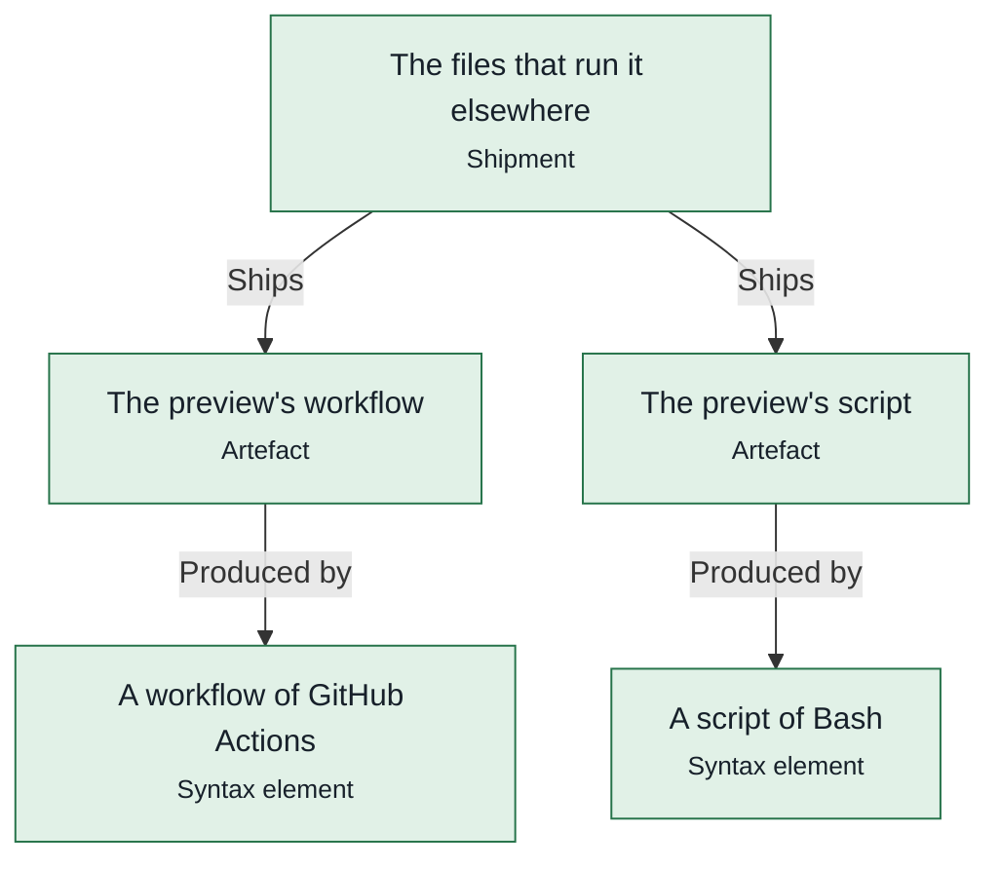

# Pipelines

*What trame ship runs for each shipment on 12 November 2026, in order, as the engine computes it: its artefacts produced, the checks a program makes, the obligations to prove, the programs that deploy it, the dossier.*

## A preview

> **A preview ships: every obligation holds.**

For the target preview; its programs are assembled for [A machine](sdlc.md#Machine).

Run elsewhere by [The preview's script](sdlc.md#PreviewScript), [The preview's workflow](sdlc.md#PreviewWorkflow), written from this pipeline by trame ship.

```mermaid
flowchart TB
  n0["Poselia's page<br/><small>Artefact</small>"]:::held
  n1["Poselia's page<br/><small>Delivery</small>"]:::neutral
  n2["The page opens<br/><small>Check</small>"]:::held
  n3["Open the page<br/><small>Entry point</small>"]:::held
  n4["The language of the home page<br/><small>Scenario</small>"]:::held
  n5["The body stays on the floor<br/><small>Scenario</small>"]:::held
  n6["Holding the poses<br/><small>Scenario</small>"]:::held
  n7["The person's breath and voice<br/><small>Scenario</small>"]:::held
  n8["Learning a sequence<br/><small>Scenario</small>"]:::held
  n9["Sequences drawn by lot<br/><small>Scenario</small>"]:::held
  n10["A practice follows the breath<br/><small>Scenario</small>"]:::held
  n11["The page is opened as a person would<br/><small>Scenario</small>"]:::held
  n12["The page is placed where it is served<br/><small>Scenario</small>"]:::held
  n13["The person's breath, kept<br/><small>Entity</small>"]:::held
  n14["three.js<br/><small>Package</small>"]:::held
  n15["three.js, its types<br/><small>Package</small>"]:::held
  n16["Each decision of architecture serves the product<br/><small>Architecture rule</small>"]:::held
  n17["Code serves the product<br/><small>Architecture rule</small>"]:::held
  n18["Place the page<br/><small>Entry point</small>"]:::held
  n19["A preview<br/><small>Shipment</small>"]:::held
  n11 -->|Verifies| n3
  n11 -->|Depends on| n3
  n11 -->|Depends on| n0
  n3 -->|Depends on| n0
  n0 -->|Produced by| n1
  n2 -->|Checks| n0
  n2 -->|Run by| n3
  n18 -->|Depends on| n0
  n12 -->|Verifies| n18
  n12 -->|Depends on| n18
  n12 -->|Depends on| n0
  n19 -->|Ships| n0
  n19 -->|Deployed by| n18
  classDef held fill:#e1f1e7,stroke:#26734a,color:#17202a
  classDef blocked fill:#fbf0d9,stroke:#9a6200,color:#17202a
  classDef violated fill:#f9e3e1,stroke:#ad2a22,color:#17202a
  classDef unknown fill:#e9edf0,stroke:#65707c,color:#17202a
  classDef neutral fill:#ffffff,stroke:#5a6672,color:#17202a
```

*Its steps, one rank per stage: produce, check, prove, deploy, record.*

|  | Stage | Step | Run by | Why | Status | Latest evidence |
|---|---|---|---|---|---|---|
| 1 | produce | [Poselia's page](sdlc.md#PageFile) · `dist/poselia.html` | [Poselia's page](app.md#PoseliaPage) | — | **held** | 12 November 2026 by claude  |
| 2 | check | [The page opens](sdlc.md#PageOpens) | [Open the page](sdlc.md#OpenThePage) | — | **held** | passed, 12 November 2026 by claude  |
| 3 | prove | The foundations | itself | every shipment: no literal in a body, a sound graph | **held** |  |
| 4 | prove | [Poselia's page](sdlc.md#PageFile) | — | the shipment | **held** | 12 November 2026 by claude  |
| 5 | prove | [The page opens](sdlc.md#PageOpens) | [Open the page](sdlc.md#OpenThePage) | [The code shown is verified, a gap said](sdlc.md#CodeVerifiedSaid) via [The browser's stage](stage.md#BrowserStage) | **held** | passed, 12 November 2026 by claude  |
| 6 | prove | [The language of the home page](scenarios.md#HomeLanguage) | — | [The code shown is verified, a gap said](sdlc.md#CodeVerifiedSaid) via [The content the app carries](app.md#CarriedContent) | **held** |  |
| 7 | prove | [The body stays on the floor](scenarios.md#BodyStaysOnTheFloor) | — | [The code shown is verified, a gap said](sdlc.md#CodeVerifiedSaid) via [The space of the mat](body.md#MatSpace) | **held** |  |
| 8 | prove | [Holding the poses](scenarios.md#HoldThePoses) | — | [The code shown is verified, a gap said](sdlc.md#CodeVerifiedSaid) via [The voice the person chose](settings.md#VoiceChoice) | **held** |  |
| 9 | prove | [The person's breath and voice](scenarios.md#PersonSettings) | — | [The code shown is verified, a gap said](sdlc.md#CodeVerifiedSaid) via [The voice the person chose](settings.md#VoiceChoice) | **held** |  |
| 10 | prove | [Learning a sequence](scenarios.md#LearnTheSequence) | — | [The code shown is verified, a gap said](sdlc.md#CodeVerifiedSaid) via [The landmarks the person chose](settings.md#MarksChoice) | **held** |  |
| 11 | prove | [Sequences drawn by lot](scenarios.md#DrawnSequencesMakeSense) | — | [The code shown is verified, a gap said](sdlc.md#CodeVerifiedSaid) via [A practice](practice.md#PracticeOf) | **held** |  |
| 12 | prove | [A practice follows the breath](scenarios.md#PracticeFollowsTheBreath) | — | [The code shown is verified, a gap said](sdlc.md#CodeVerifiedSaid) via [A practice](practice.md#PracticeOf) | **held** |  |
| 13 | prove | [The page is opened as a person would](sdlc.md#OpeningThePage) | — | [The code shown is verified, a gap said](sdlc.md#CodeVerifiedSaid) via [Open the page](sdlc.md#OpenThePage) | **held** |  |
| 14 | prove | [The page is placed where it is served](sdlc.md#PlacingThePage) | — | [The code shown is verified, a gap said](sdlc.md#CodeVerifiedSaid) via [Place the page](sdlc.md#PlaceThePage) | **held** |  |
| 15 | prove | [The person's breath, kept](settings.md#Breath) | — | [What the device keeps, migrated](sdlc.md#KeptMigrates) | **held** |  |
| 16 | prove | [three.js](stage.md#ThreePackage) | — | [The packages are safe](sdlc.md#PackagesSafe) via [The browser's stage](stage.md#BrowserStage) | **held** | 29 October 2026 by   |
| 17 | prove | [three.js, its types](stage.md#ThreeTypes) | — | [The packages are safe](sdlc.md#PackagesSafe) via [The browser's stage](stage.md#BrowserStage) | **held** | 29 October 2026 by   |
| 18 | prove | [Each decision of architecture serves the product](sdlc.md#AdrsServeTheProduct) | — | [The rules of the app hold](sdlc.md#RulesHeld) | **held** |  |
| 19 | prove | [Code serves the product](sdlc.md#CodeServesTheProduct) | — | [The rules of the app hold](sdlc.md#RulesHeld) | **held** |  |
| 20 | deploy | [Place the page](sdlc.md#PlaceThePage) | itself | — | **held** | 12 November 2026 by claude  |
| 21 | record | [A preview](sdlc.md#Preview) | — | — | **held** | 12 November 2026 by claude `evidence/shipments/Preview-2026-11-12-8fe927b1.json` |

`trame ship Preview --by <name>`

## A public version

> **A public version does not ship yet: 51 of 55 obligations hold.**

For the target public; its programs are assembled for [A machine](sdlc.md#Machine).

```mermaid
flowchart TB
  n0["Poselia's page<br/><small>Artefact</small>"]:::held
  n1["The page opens<br/><small>Check</small>"]:::held
  n2["Open the page<br/><small>Entry point</small>"]:::held
  n3["A preview<br/><small>Shipment</small>"]:::held
  n4["On a phone<br/><small>Check</small>"]:::unknown
  n5["The language of the home page<br/><small>Scenario</small>"]:::held
  n6["The body stays on the floor<br/><small>Scenario</small>"]:::held
  n7["Holding the poses<br/><small>Scenario</small>"]:::held
  n8["The person's breath and voice<br/><small>Scenario</small>"]:::held
  n9["Learning a sequence<br/><small>Scenario</small>"]:::held
  n10["Sequences drawn by lot<br/><small>Scenario</small>"]:::held
  n11["A practice follows the breath<br/><small>Scenario</small>"]:::held
  n12["The page is opened as a person would<br/><small>Scenario</small>"]:::held
  n13["The page is placed where it is served<br/><small>Scenario</small>"]:::held
  n14["The content, reviewed<br/><small>Review</small>"]:::unknown
  n15["A page first, the phones after<br/><small>Architecture decision</small>"]:::held
  n16["The content is data, behind a port<br/><small>Architecture decision</small>"]:::unknown
  n17["The person's language, among those offered<br/><small>Architecture decision</small>"]:::held
  n18["The breath is the clock<br/><small>Architecture decision</small>"]:::held
  n19["Said aloud, the screen awake<br/><small>Architecture decision</small>"]:::unknown
  n20["The person's breath, kept<br/><small>Entity</small>"]:::held
  n21["three.js<br/><small>Package</small>"]:::held
  n22["three.js, its types<br/><small>Package</small>"]:::held
  n23["The angle at a joint<br/><small>Requirement</small>"]:::held
  n24["The body between two poses<br/><small>Requirement</small>"]:::held
  n25["A foot on its way<br/><small>Requirement</small>"]:::held
  n26["A hand on its way<br/><small>Requirement</small>"]:::held
  n27["A pose ready to move<br/><small>Requirement</small>"]:::held
  n28["Legs apart<br/><small>Requirement</small>"]:::held
  n29["Every limb reaches<br/><small>Requirement</small>"]:::held
  n30["A leg on its foot<br/><small>Requirement</small>"]:::held
  n31["A pose rests on what it names<br/><small>Requirement</small>"]:::held
  n32["The legs in front and behind<br/><small>Requirement</small>"]:::held
  n33["Where a spot is<br/><small>Requirement</small>"]:::held
  n34["A leg that steps<br/><small>Requirement</small>"]:::held
  n35["The heights of the body's surface<br/><small>Requirement</small>"]:::held
  n36["The trunk from its angles<br/><small>Requirement</small>"]:::held
  n37["A limb reaches its end<br/><small>Requirement</small>"]:::held
  n38["Rising on a breath in<br/><small>Requirement</small>"]:::held
  n39["Where the leading leg goes<br/><small>Requirement</small>"]:::held
  n40["A sequence that makes sense<br/><small>Requirement</small>"]:::held
  n41["How long words take to say<br/><small>Requirement</small>"]:::held
  n42["A landmark on the body<br/><small>Requirement</small>"]:::held
  n43["The language of the app<br/><small>Requirement</small>"]:::held
  n44["Breaths to say a cue<br/><small>Requirement</small>"]:::held
  n45["A movement goes as a breath goes<br/><small>Requirement</small>"]:::held
  n46["A hold of whole breaths<br/><small>Requirement</small>"]:::held
  n47["How full the lungs are<br/><small>Requirement</small>"]:::held
  n48["Where a practice is<br/><small>Requirement</small>"]:::held
  n49["The breath of a moment<br/><small>Requirement</small>"]:::held
  n50["A phase set by the person<br/><small>Requirement</small>"]:::held
  n51["A breath within its bounds<br/><small>Requirement</small>"]:::held
  n52["A breath measured by tapping<br/><small>Requirement</small>"]:::held
  n53["Each decision of architecture serves the product<br/><small>Architecture rule</small>"]:::held
  n54["Code serves the product<br/><small>Architecture rule</small>"]:::held
  n55["Place the page<br/><small>Entry point</small>"]:::held
  n56["A public version<br/><small>Shipment</small>"]:::unknown
  n24 -->|Depends on| n36
  n24 -->|Depends on| n34
  n24 -->|Depends on| n25
  n24 -->|Depends on| n30
  n24 -->|Depends on| n26
  n24 -->|Depends on| n37
  n27 -->|Depends on| n36
  n29 -->|Depends on| n27
  n29 -->|Depends on| n24
  n30 -->|Depends on| n37
  n31 -->|Depends on| n27
  n31 -->|Depends on| n24
  n31 -->|Depends on| n35
  n34 -->|Depends on| n37
  n38 -->|Depends on| n27
  n38 -->|Depends on| n24
  n42 -->|Depends on| n33
  n42 -->|Depends on| n23
  n44 -->|Depends on| n41
  n18 -->|Applied by| n49
  n18 -->|Applied by| n46
  n17 -->|Applied by| n43
  n15 -->|Applied by| n1
  n6 -->|Verifies| n24
  n6 -->|Verifies| n35
  n6 -->|Verifies| n34
  n6 -->|Verifies| n30
  n6 -->|Verifies| n26
  n6 -->|Verifies| n25
  n6 -->|Verifies| n27
  n6 -->|Verifies| n36
  n6 -->|Verifies| n37
  n6 -->|Depends on| n35
  n10 -->|Verifies| n40
  n10 -->|Verifies| n39
  n10 -->|Verifies| n38
  n10 -->|Depends on| n40
  n10 -->|Depends on| n35
  n7 -->|Verifies| n46
  n7 -->|Verifies| n44
  n9 -->|Verifies| n42
  n8 -->|Verifies| n52
  n8 -->|Verifies| n50
  n4 -->|Checks| n0
  n12 -->|Verifies| n2
  n12 -->|Depends on| n2
  n12 -->|Depends on| n0
  n2 -->|Depends on| n0
  n1 -->|Checks| n0
  n1 -->|Run by| n2
  n55 -->|Depends on| n0
  n13 -->|Verifies| n55
  n13 -->|Depends on| n55
  n13 -->|Depends on| n0
  n3 -->|Ships| n0
  n3 -->|Deployed by| n55
  n56 -->|Ships| n0
  n56 -->|Deployed by| n55
  classDef held fill:#e1f1e7,stroke:#26734a,color:#17202a
  classDef blocked fill:#fbf0d9,stroke:#9a6200,color:#17202a
  classDef violated fill:#f9e3e1,stroke:#ad2a22,color:#17202a
  classDef unknown fill:#e9edf0,stroke:#65707c,color:#17202a
  classDef neutral fill:#ffffff,stroke:#5a6672,color:#17202a
```

*Its steps, one rank per stage: produce, check, prove, deploy, record.*

|  | Stage | Step | Run by | Why | Status | Latest evidence |
|---|---|---|---|---|---|---|
| 1 | produce | [Poselia's page](sdlc.md#PageFile) · `dist/poselia.html` | promoted, as shipped first by [A preview](sdlc.md#Preview) | — | **held** | 12 November 2026 by claude  |
| 2 | check | [The page opens](sdlc.md#PageOpens) | [Open the page](sdlc.md#OpenThePage) | — | **held** | passed, 12 November 2026 by claude  |
| 3 | prove | The foundations | itself | every shipment: no literal in a body, a sound graph | **held** |  |
| 4 | prove | [Poselia's page](sdlc.md#PageFile) | — | the shipment | **held** | 12 November 2026 by claude  |
| 5 | prove | [A preview](sdlc.md#Preview) | — | [After the preview](sdlc.md#AfterThePreview) via [Poselia's page](sdlc.md#PageFile) | **held** | 12 November 2026 by claude `evidence/shipments/Preview-2026-11-12-8fe927b1.json` |
| 6 | prove | [On a phone](sdlc.md#OnAPhone) | by hand, signed by [People who try it on a phone](sdlc.md#PhoneTesters) | [The page is checked, by hand too](sdlc.md#AllChecks) via [Poselia's page](sdlc.md#PageFile) | **unknown** |  |
| 7 | prove | [The page opens](sdlc.md#PageOpens) | [Open the page](sdlc.md#OpenThePage) | [The page is checked, by hand too](sdlc.md#AllChecks) via [Poselia's page](sdlc.md#PageFile) | **held** | passed, 12 November 2026 by claude  |
| 8 | prove | [The language of the home page](scenarios.md#HomeLanguage) | — | [The code shown is verified](sdlc.md#CodeVerified) via [The content the app carries](app.md#CarriedContent) | **held** |  |
| 9 | prove | [The body stays on the floor](scenarios.md#BodyStaysOnTheFloor) | — | [The code shown is verified](sdlc.md#CodeVerified) via [The space of the mat](body.md#MatSpace) | **held** |  |
| 10 | prove | [Holding the poses](scenarios.md#HoldThePoses) | — | [The code shown is verified](sdlc.md#CodeVerified) via [The voice the person chose](settings.md#VoiceChoice) | **held** |  |
| 11 | prove | [The person's breath and voice](scenarios.md#PersonSettings) | — | [The code shown is verified](sdlc.md#CodeVerified) via [The voice the person chose](settings.md#VoiceChoice) | **held** |  |
| 12 | prove | [Learning a sequence](scenarios.md#LearnTheSequence) | — | [The code shown is verified](sdlc.md#CodeVerified) via [The landmarks the person chose](settings.md#MarksChoice) | **held** |  |
| 13 | prove | [Sequences drawn by lot](scenarios.md#DrawnSequencesMakeSense) | — | [The code shown is verified](sdlc.md#CodeVerified) via [A practice](practice.md#PracticeOf) | **held** |  |
| 14 | prove | [A practice follows the breath](scenarios.md#PracticeFollowsTheBreath) | — | [The code shown is verified](sdlc.md#CodeVerified) via [A practice](practice.md#PracticeOf) | **held** |  |
| 15 | prove | [The page is opened as a person would](sdlc.md#OpeningThePage) | — | [The code shown is verified](sdlc.md#CodeVerified) via [Open the page](sdlc.md#OpenThePage) | **held** |  |
| 16 | prove | [The page is placed where it is served](sdlc.md#PlacingThePage) | — | [The code shown is verified](sdlc.md#CodeVerified) via [Place the page](sdlc.md#PlaceThePage) | **held** |  |
| 17 | prove | [The content, reviewed](sdlc.md#ContentReviewed) | reviewed by [A teacher who practises](sdlc.md#Teachers) | [The content is reviewed by a teacher](sdlc.md#ContentSeen) via [Poses](content.md#Poses) | **unknown** |  |
| 18 | prove | [A page first, the phones after](principles.md#PageFirst) | — | [The decisions hold](sdlc.md#DecisionsApplied) via [Poselia's page](app.md#PoseliaPage) | **held** |  |
| 19 | prove | [The content is data, behind a port](principles.md#ContentAsData) | — | [The decisions hold](sdlc.md#DecisionsApplied) via [Poses](content.md#Poses) | **unknown** |  |
| 20 | prove | [The person's language, among those offered](principles.md#LanguageOffered) | — | [The decisions hold](sdlc.md#DecisionsApplied) via [Languages offered](content.md#Languages) | **held** |  |
| 21 | prove | [The breath is the clock](principles.md#BreathIsTheClock) | — | [The decisions hold](sdlc.md#DecisionsApplied) via [The breath of a moment](product.md#BreathOf) | **held** |  |
| 22 | prove | [Said aloud, the screen awake](principles.md#SaidAloud) | — | [The decisions hold](sdlc.md#DecisionsApplied) via [Play a practice](practice.md#PlayPractice) | **unknown** |  |
| 23 | prove | [The person's breath, kept](settings.md#Breath) | — | [What the device keeps, migrated](sdlc.md#KeptMigrates) | **held** |  |
| 24 | prove | [three.js](stage.md#ThreePackage) | — | [The packages are safe](sdlc.md#PackagesSafe) via [The browser's stage](stage.md#BrowserStage) | **held** | 29 October 2026 by   |
| 25 | prove | [three.js, its types](stage.md#ThreeTypes) | — | [The packages are safe](sdlc.md#PackagesSafe) via [The browser's stage](stage.md#BrowserStage) | **held** | 29 October 2026 by   |
| 26 | prove | [The angle at a joint](body.md#AngleBetween) | — | [The product holds](sdlc.md#ProductServed) via [Poselia's page](app.md#PoseliaPage) | **held** |  |
| 27 | prove | [The body between two poses](body.md#BodyAt) | — | [The product holds](sdlc.md#ProductServed) via [Poselia's page](app.md#PoseliaPage) | **held** |  |
| 28 | prove | [A foot on its way](body.md#FootOnItsWay) | — | [The product holds](sdlc.md#ProductServed) via [Poselia's page](app.md#PoseliaPage) | **held** |  |
| 29 | prove | [A hand on its way](body.md#HandOnItsWay) | — | [The product holds](sdlc.md#ProductServed) via [Poselia's page](app.md#PoseliaPage) | **held** |  |
| 30 | prove | [A pose ready to move](body.md#KeyOf) | — | [The product holds](sdlc.md#ProductServed) via [Poselia's page](app.md#PoseliaPage) | **held** |  |
| 31 | prove | [Legs apart](body.md#LegsApart) | — | [The product holds](sdlc.md#ProductServed) via [Poselia's page](app.md#PoseliaPage) | **held** |  |
| 32 | prove | [Every limb reaches](body.md#LimbsReach) | — | [The product holds](sdlc.md#ProductServed) via [Poselia's page](app.md#PoseliaPage) | **held** |  |
| 33 | prove | [A leg on its foot](body.md#PlantedLeg) | — | [The product holds](sdlc.md#ProductServed) via [Poselia's page](app.md#PoseliaPage) | **held** |  |
| 34 | prove | [A pose rests on what it names](body.md#RestsOnWhatItNames) | — | [The product holds](sdlc.md#ProductServed) via [Poselia's page](app.md#PoseliaPage) | **held** |  |
| 35 | prove | [The legs in front and behind](body.md#SidesOf) | — | [The product holds](sdlc.md#ProductServed) via [Poselia's page](app.md#PoseliaPage) | **held** |  |
| 36 | prove | [Where a spot is](body.md#SpotOn) | — | [The product holds](sdlc.md#ProductServed) via [Poselia's page](app.md#PoseliaPage) | **held** |  |
| 37 | prove | [A leg that steps](body.md#SteppingLeg) | — | [The product holds](sdlc.md#ProductServed) via [Poselia's page](app.md#PoseliaPage) | **held** |  |
| 38 | prove | [The heights of the body's surface](body.md#SurfaceHeights) | — | [The product holds](sdlc.md#ProductServed) via [Poselia's page](app.md#PoseliaPage) | **held** |  |
| 39 | prove | [The trunk from its angles](body.md#TrunkOf) | — | [The product holds](sdlc.md#ProductServed) via [Poselia's page](app.md#PoseliaPage) | **held** |  |
| 40 | prove | [A limb reaches its end](body.md#TwoBones) | — | [The product holds](sdlc.md#ProductServed) via [Poselia's page](app.md#PoseliaPage) | **held** |  |
| 41 | prove | [Rising on a breath in](composing.md#BreathOfMove) | — | [The product holds](sdlc.md#ProductServed) via [Poselia's page](app.md#PoseliaPage) | **held** |  |
| 42 | prove | [Where the leading leg goes](content.md#LeadingLegOf) | — | [The product holds](sdlc.md#ProductServed) via [Poselia's page](app.md#PoseliaPage) | **held** |  |
| 43 | prove | [A sequence that makes sense](content.md#MakesSense) | — | [The product holds](sdlc.md#ProductServed) via [Poselia's page](app.md#PoseliaPage) | **held** |  |
| 44 | prove | [How long words take to say](content.md#Spoken) | — | [The product holds](sdlc.md#ProductServed) via [Poselia's page](app.md#PoseliaPage) | **held** |  |
| 45 | prove | [A landmark on the body](marks.md#MarkOnBody) | — | [The product holds](sdlc.md#ProductServed) via [Poselia's page](app.md#PoseliaPage) | **held** |  |
| 46 | prove | [The language of the app](product.md#ChosenLanguage) | — | [The product holds](sdlc.md#ProductServed) | **held** |  |
| 47 | prove | [Breaths to say a cue](practice.md#BreathsToSay) | — | [The product holds](sdlc.md#ProductServed) via [The breath of a moment](product.md#BreathOf) | **held** |  |
| 48 | prove | [A movement goes as a breath goes](practice.md#Eased) | — | [The product holds](sdlc.md#ProductServed) via [The breath of a moment](product.md#BreathOf) | **held** |  |
| 49 | prove | [A hold of whole breaths](practice.md#HoldPhases) | — | [The product holds](sdlc.md#ProductServed) via [The breath of a moment](product.md#BreathOf) | **held** |  |
| 50 | prove | [How full the lungs are](practice.md#LungsFull) | — | [The product holds](sdlc.md#ProductServed) via [The breath of a moment](product.md#BreathOf) | **held** |  |
| 51 | prove | [Where a practice is](practice.md#MomentAt) | — | [The product holds](sdlc.md#ProductServed) via [The breath of a moment](product.md#BreathOf) | **held** |  |
| 52 | prove | [The breath of a moment](product.md#BreathOf) | — | [The product holds](sdlc.md#ProductServed) | **held** |  |
| 53 | prove | [A phase set by the person](settings.md#AdjustedBreath) | — | [The product holds](sdlc.md#ProductServed) via [The breath of a moment](product.md#BreathOf) | **held** |  |
| 54 | prove | [A breath within its bounds](settings.md#BreathWithinBounds) | — | [The product holds](sdlc.md#ProductServed) via [The breath of a moment](product.md#BreathOf) | **held** |  |
| 55 | prove | [A breath measured by tapping](settings.md#MeasuredBreath) | — | [The product holds](sdlc.md#ProductServed) via [The breath of a moment](product.md#BreathOf) | **held** |  |
| 56 | prove | [Each decision of architecture serves the product](sdlc.md#AdrsServeTheProduct) | — | [The rules of the app hold](sdlc.md#RulesHeld) | **held** |  |
| 57 | prove | [Code serves the product](sdlc.md#CodeServesTheProduct) | — | [The rules of the app hold](sdlc.md#RulesHeld) | **held** |  |
| 58 | deploy | [Place the page](sdlc.md#PlaceThePage) | itself | — | **held** | 12 November 2026 by claude  |
| 59 | record | [A public version](sdlc.md#PublicVersion) | — | — | **unknown** |  |

`trame ship PublicVersion --by <name>`

## The files that run it elsewhere

> **The files that run it elsewhere ships: every obligation holds.**

For the target repository.

*Its steps, one rank per stage: produce, check, prove, deploy, record.*

|  | Stage | Step | Run by | Why | Status | Latest evidence |
|---|---|---|---|---|---|---|
| 1 | produce | [The preview's script](sdlc.md#PreviewScript) · `scripts/ship-preview.sh` | [A script of Bash](../.trame/ci/docs/shell.md#ShellScript) | — | **held** | 12 November 2026 by claude  |
| 2 | produce | [The preview's workflow](sdlc.md#PreviewWorkflow) · `../../.github/workflows/poselia-preview.yml` | [A workflow of GitHub Actions](../.trame/ci/docs/github.md#GitHubWorkflow) | — | **held** | 12 November 2026 by claude  |
| 3 | prove | The foundations | itself | every shipment: no literal in a body, a sound graph | **held** |  |
| 4 | prove | [The preview's script](sdlc.md#PreviewScript) | — | the shipment | **held** | 12 November 2026 by claude  |
| 5 | prove | [The preview's workflow](sdlc.md#PreviewWorkflow) | — | the shipment | **held** | 12 November 2026 by claude  |
| 6 | record | [The files that run it elsewhere](sdlc.md#RunnersWritten) | — | — | **held** | 12 November 2026 by claude `evidence/shipments/RunnersWritten-2026-11-12-9728be9e.json` |

`trame ship RunnersWritten --by <name>`
