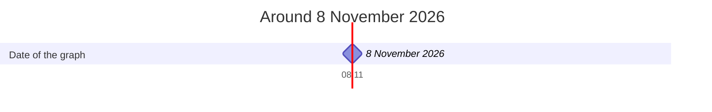

# Timeline

*What comes into force, stops or reaches its deadline, around 8 November 2026.*

*The bars are the periods of validity, and the marks are the deadlines and reviews. The line marks the date of the graph.*
