# Pipelines

*What trame ship runs for each shipment on 1 November 2026, in order, as the engine computes it: its artefacts produced, the checks a program makes, the obligations to prove, the programs that deploy it, the dossier.*

## The next generation

> **The next generation does not ship yet: 91 of 98 obligations hold.**

For the target generation; its programs are assembled for [Local](architecture.md#Local).

```mermaid
flowchart TB
  n0["The candidate engine<br/><small>Artefact</small>"]:::unknown
  n1["Trame on the command line<br/><small>Component</small>"]:::neutral
  n2["The page's program<br/><small>Artefact</small>"]:::held
  n3["The page in a browser<br/><small>Component</small>"]:::neutral
  n4["The graph page<br/><small>Artefact</small>"]:::unknown
  n5["Export the page<br/><small>Entry point</small>"]:::held
  n6["The candidate plays the laws<br/><small>Check</small>"]:::unknown
  n7["Test the laws<br/><small>Entry point</small>"]:::held
  n8["The candidate runs on the machine<br/><small>Check</small>"]:::unknown
  n9["Ask the machine<br/><small>Entry point</small>"]:::held
  n10["The graph page opens<br/><small>Check</small>"]:::unknown
  n11["Open the graph page<br/><small>Entry point</small>"]:::held
  n12["The engine: a graph like any product's<br/><small>Architecture decision</small>"]:::held
  n13["The words are in catalogs<br/><small>Architecture decision</small>"]:::held
  n14["A library is a Trame project, imported by path<br/><small>Architecture decision</small>"]:::held
  n15["The graph is written in TypeScript<br/><small>Architecture decision</small>"]:::held
  n16["A library is imported by its name<br/><small>Architecture decision</small>"]:::held
  n17["The prelude and the compiler know no kind of node<br/><small>Architecture decision</small>"]:::held
  n18["A package is used by its name<br/><small>Architecture decision</small>"]:::held
  n19["Kinds and views: the vocabulary, as reviewed files<br/><small>Architecture decision</small>"]:::held
  n20["The punctuation is the language's<br/><small>Architecture decision</small>"]:::held
  n21["A catalog counts in its language<br/><small>Architecture decision</small>"]:::held
  n22["The prelude: the runtime of the language<br/><small>Architecture decision</small>"]:::held
  n23["A key is made of its parts<br/><small>Architecture decision</small>"]:::held
  n24["The data a product carries is a dataset<br/><small>Architecture decision</small>"]:::held
  n25["The language receives the graph's values<br/><small>Architecture decision</small>"]:::held
  n26["The traversal API is the only way to read the graph<br/><small>Architecture decision</small>"]:::held
  n27["A literal in a body is an error<br/><small>Architecture decision</small>"]:::held
  n28["A literal in a kind or a view is an error<br/><small>Architecture decision</small>"]:::held
  n29["tree-sitter says what it keeps aside<br/><small>Architecture decision</small>"]:::held
  n30["Every language is read alike, with tree-sitter<br/><small>Architecture decision</small>"]:::held
  n31["Code holds no hidden decision<br/><small>Architecture decision</small>"]:::held
  n32["What a writer writes is read back before it is written<br/><small>Architecture decision</small>"]:::held
  n33["An undecided value blocks; it does not crash<br/><small>Architecture decision</small>"]:::held
  n34["A change to a node is a claim<br/><small>Architecture decision</small>"]:::held
  n35["The graph: the description of a product<br/><small>Architecture decision</small>"]:::held
  n36["The laws are requirements<br/><small>Architecture decision</small>"]:::held
  n37["Without evidence, a status is unknown<br/><small>Architecture decision</small>"]:::held
  n38["The source carries the history<br/><small>Architecture decision</small>"]:::held
  n39["Kinds and views say what; renderers say how<br/><small>Architecture decision</small>"]:::held
  n40["Generations: frozen engines<br/><small>Architecture decision</small>"]:::held
  n41["Trame builds Trame<br/><small>Architecture decision</small>"]:::held
  n42["One output for each reader<br/><small>Architecture decision</small>"]:::held
  n43["One renderer, its syntax a choice<br/><small>Architecture decision</small>"]:::held
  n44["A product is delivered by a node of the graph<br/><small>Architecture decision</small>"]:::held
  n45["A style sheet writes no value<br/><small>Architecture decision</small>"]:::held
  n46["The SDLC's tooling is realized once<br/><small>Architecture decision</small>"]:::unknown
  n47["The page is assembled<br/><small>Architecture decision</small>"]:::unknown
  n48["Effects come from the vocabulary<br/><small>Architecture rule</small>"]:::held
  n49["Only commands write<br/><small>Architecture rule</small>"]:::held
  n50["Rendering does not read the graph<br/><small>Architecture rule</small>"]:::held
  n51["Grammar of TypeScript<br/><small>Package</small>"]:::held
  n52["tsx<br/><small>Package</small>"]:::held
  n53["TypeScript<br/><small>Package</small>"]:::held
  n54["Types of Node.js<br/><small>Package</small>"]:::held
  n55["web-tree-sitter<br/><small>Package</small>"]:::held
  n56["Grammar of CSS<br/><small>Package</small>"]:::held
  n57["Grammar of HCL<br/><small>Package</small>"]:::held
  n58["esbuild<br/><small>Package</small>"]:::held
  n59["Grammar of HTML<br/><small>Package</small>"]:::held
  n60["Playwright<br/><small>Package</small>"]:::held
  n61["The command line<br/><small>Scenario</small>"]:::held
  n62["The engine reckons as it says<br/><small>Scenario</small>"]:::held
  n63["The described engine compiles the example<br/><small>Scenario</small>"]:::held
  n64["Shipments run, evidence given<br/><small>Scenario</small>"]:::held
  n65["An advance, in memory<br/><small>Scenario</small>"]:::held
  n66["The documents write in the decided language<br/><small>Scenario</small>"]:::held
  n67["A body is read and checked<br/><small>Scenario</small>"]:::held
  n68["A component assembled<br/><small>Scenario</small>"]:::held
  n69["The doctor<br/><small>Scenario</small>"]:::held
  n70["The build writes the same documents as the engine in place<br/><small>Scenario</small>"]:::held
  n71["The laws of the kinds hold<br/><small>Scenario</small>"]:::held
  n72["A library released<br/><small>Scenario</small>"]:::held
  n73["The manifest written<br/><small>Scenario</small>"]:::held
  n74["A value amended<br/><small>Scenario</small>"]:::held
  n75["The packages audited<br/><small>Scenario</small>"]:::held
  n76["A view in the terminal<br/><small>Scenario</small>"]:::held
  n77["The page of the graph<br/><small>Scenario</small>"]:::held
  n78["The page delivered<br/><small>Scenario</small>"]:::held
  n79["trame dev<br/><small>Scenario</small>"]:::held
  n80["The page exported<br/><small>Scenario</small>"]:::held
  n81["The graph in the intermediate format<br/><small>Scenario</small>"]:::held
  n82["A project started<br/><small>Scenario</small>"]:::held
  n83["A build planned<br/><small>Scenario</small>"]:::held
  n84["Declarations published<br/><small>Scenario</small>"]:::held
  n85["A component run<br/><small>Scenario</small>"]:::held
  n86["The snapshot, taken by its command<br/><small>Scenario</small>"]:::held
  n87["The laws, tested by their command<br/><small>Scenario</small>"]:::held
  n88["The graph page is opened as a person would<br/><small>Scenario</small>"]:::held
  n89["Accept a candidate<br/><small>Requirement</small>"]:::held
  n90["Sort problems by severity<br/><small>Requirement</small>"]:::held
  n91["Ship only what holds<br/><small>Requirement</small>"]:::held
  n92["What belongs to a library<br/><small>Requirement</small>"]:::held
  n93["A release is settled<br/><small>Requirement</small>"]:::held
  n94["Answers without crashing<br/><small>Requirement</small>"]:::held
  n95["A blocking hole has an owner<br/><small>Requirement</small>"]:::held
  n96["The resolution returns only what it is given<br/><small>Requirement</small>"]:::held
  n97["Complete declaration<br/><small>Requirement</small>"]:::held
  n98["Complete declaration of a view<br/><small>Requirement</small>"]:::held
  n99["Produces only the intermediate format<br/><small>Requirement</small>"]:::held
  n100["Same input, same answer<br/><small>Requirement</small>"]:::held
  n101["The resolution does not depend on the order<br/><small>Requirement</small>"]:::held
  n102["Without evidence, the status is unknown<br/><small>Requirement</small>"]:::held
  n103["Advance<br/><small>Entry point</small>"]:::held
  n104["The next generation<br/><small>Shipment</small>"]:::unknown
  n47 -->|Applied by| n50
  n65 -->|Verifies| n103
  n65 -->|Depends on| n103
  n69 -->|Verifies| n9
  n69 -->|Depends on| n9
  n87 -->|Verifies| n7
  n87 -->|Depends on| n7
  n80 -->|Verifies| n5
  n80 -->|Depends on| n5
  n103 -->|Part of| n1
  n103 -->|Depends on| n89
  n9 -->|Part of| n1
  n5 -->|Part of| n1
  n7 -->|Part of| n1
  n101 -->|Refines| n100
  n101 -->|Depends on| n100
  n12 -->|Applied by| n1
  n12 -->|Applied by| n50
  n12 -->|Applied by| n49
  n12 -->|Applied by| n48
  n40 -->|Applied by| n103
  n40 -->|Applied by| n89
  n40 -->|Applied by| n70
  n14 -->|Applied by| n92
  n14 -->|Applied by| n103
  n16 -->|Applied by| n93
  n31 -->|Applied by| n48
  n31 -->|Applied by| n49
  n26 -->|Applied by| n50
  n18 -->|Applied by| n103
  n41 -->|Applied by| n103
  n41 -->|Applied by| n89
  n41 -->|Applied by| n63
  n41 -->|Applied by| n70
  n41 -->|Applied by| n71
  n37 -->|Applied by| n71
  n39 -->|Applied by| n50
  n6 -->|Checks| n0
  n6 -->|Run by| n7
  n8 -->|Checks| n0
  n8 -->|Run by| n9
  n0 -->|Produced by| n1
  n4 -->|Produced by| n5
  n4 -->|Carries| n3
  n10 -->|Checks| n4
  n10 -->|Run by| n11
  n104 -->|Ships| n0
  n104 -->|Ships| n2
  n104 -->|Ships| n4
  n104 -->|Deployed by| n103
  n88 -->|Verifies| n11
  n88 -->|Depends on| n11
  n88 -->|Depends on| n4
  n11 -->|Depends on| n4
  n2 -->|Produced by| n3
  classDef held fill:#e1f1e7,stroke:#26734a,color:#17202a
  classDef blocked fill:#fbf0d9,stroke:#9a6200,color:#17202a
  classDef violated fill:#f9e3e1,stroke:#ad2a22,color:#17202a
  classDef unknown fill:#e9edf0,stroke:#65707c,color:#17202a
  classDef neutral fill:#ffffff,stroke:#5a6672,color:#17202a
```

*Its steps, one rank per stage: produce, check, prove, deploy, record.*

|  | Stage | Step | Run by | Why | Status | Latest evidence |
|---|---|---|---|---|---|---|
| 1 | produce | [The candidate engine](sdlc.md#EngineCandidate) · `out/local/trame-cli.ts` | [Trame on the command line](architecture.md#TrameCli) | — | **unknown** | 1 November 2026 by claude  |
| 2 | produce | [The page's program](sdlc.md#PageProgram) · `out/browser/page-app.ts` | [The page in a browser](architecture.md#PageApp) | — | **held** | 1 November 2026 by claude  |
| 3 | produce | [The graph page](sdlc.md#GraphPage) · `trame-page.html` | [Export the page](commands.md#Export) | — | **unknown** | 1 November 2026 by claude  |
| 4 | check | [The candidate plays the laws](sdlc.md#CandidateKeepsTheLaws) | [Test the laws](commands.md#TestKinds), signed by [Trame's maintainers](sdlc.md#Maintainers) | — | **unknown** | passed, 1 November 2026 by claude  |
| 5 | check | [The candidate runs on the machine](sdlc.md#CandidateRunsOnTheMachine) | [Ask the machine](commands.md#Doctor), signed by [Trame's maintainers](sdlc.md#Maintainers) | — | **unknown** | passed, 1 November 2026 by claude  |
| 6 | check | [The graph page opens](sdlc.md#GraphPageOpens) | [Open the graph page](sdlc.md#OpenTheGraphPage), signed by [Trame's maintainers](sdlc.md#Maintainers) | — | **unknown** | passed, 1 November 2026 by claude  |
| 7 | prove | The foundations | itself | every shipment: no literal in a body, a sound graph | **held** |  |
| 8 | prove | [The candidate engine](sdlc.md#EngineCandidate) | — | the shipment | **unknown** | 1 November 2026 by claude  |
| 9 | prove | [The graph page](sdlc.md#GraphPage) | — | the shipment | **unknown** | 1 November 2026 by claude  |
| 10 | prove | [The page's program](sdlc.md#PageProgram) | — | the shipment | **held** | 1 November 2026 by claude  |
| 11 | prove | [The engine: a graph like any product's](principles.md#EngineLayer) | — | [The decisions of the architecture hold](sdlc.md#ArchitectureApplied) via [Trame on the command line](architecture.md#TrameCli) | **held** |  |
| 12 | prove | [The words are in catalogs](principles.md#WordsInCatalogs) | — | [The decisions of the architecture hold](sdlc.md#ArchitectureApplied) via [Messages of the platform](messages.md#PlatformMessages) | **held** |  |
| 13 | prove | [A library is a Trame project, imported by path](principles.md#LibrariesAreProjects) | — | [The decisions of the architecture hold](sdlc.md#ArchitectureApplied) via [What belongs to a library](libraries.md#LibraryOfAModule) | **held** |  |
| 14 | prove | [The graph is written in TypeScript](principles.md#GraphInTypeScript) | — | [The decisions of the architecture hold](sdlc.md#ArchitectureApplied) via [TypeScript](typescript.md#TypeScript) | **held** |  |
| 15 | prove | [A library is imported by its name](principles.md#LibrariesByName) | — | [The decisions of the architecture hold](sdlc.md#ArchitectureApplied) via [Project](engine.md#Project) | **held** |  |
| 16 | prove | [The prelude and the compiler know no kind of node](principles.md#NoKindInTheCore) | — | [The decisions of the architecture hold](sdlc.md#ArchitectureApplied) via [Project](engine.md#Project) | **held** |  |
| 17 | prove | [A package is used by its name](principles.md#PackagesByName) | — | [The decisions of the architecture hold](sdlc.md#ArchitectureApplied) via [Project](engine.md#Project) | **held** |  |
| 18 | prove | [Kinds and views: the vocabulary, as reviewed files](principles.md#VocabularyLayer) | — | [The decisions of the architecture hold](sdlc.md#ArchitectureApplied) via [Project](engine.md#Project) | **held** |  |
| 19 | prove | [The punctuation is the language's](documents.md#PunctuationOfTheLanguage) | — | [The decisions of the architecture hold](sdlc.md#ArchitectureApplied) via [Language](messages.md#Language) | **held** |  |
| 20 | prove | [A catalog counts in its language](messages.md#CountsInTheLanguage) | — | [The decisions of the architecture hold](sdlc.md#ArchitectureApplied) via [Lists](messages.md#Lists) | **held** |  |
| 21 | prove | [The prelude: the runtime of the language](principles.md#PreludeLayer) | — | [The decisions of the architecture hold](sdlc.md#ArchitectureApplied) via [The prelude's public API](conventions.md#PreludeApi) | **held** |  |
| 22 | prove | [A key is made of its parts](principles.md#KeysOfParts) | — | [The decisions of the architecture hold](sdlc.md#ArchitectureApplied) via [Static reading](engine.md#StaticAnalysis) | **held** |  |
| 23 | prove | [The data a product carries is a dataset](principles.md#DataAsDatasets) | — | [The decisions of the architecture hold](sdlc.md#ArchitectureApplied) via [Fingerprints](engine.md#Fingerprints) | **held** |  |
| 24 | prove | [The language receives the graph's values](engine.md#TheLanguageReceivesTheGraph) | — | [The decisions of the architecture hold](sdlc.md#ArchitectureApplied) via [Graph](engine.md#GraphApi) | **held** |  |
| 25 | prove | [The traversal API is the only way to read the graph](principles.md#OneWayToRead) | — | [The decisions of the architecture hold](sdlc.md#ArchitectureApplied) via [Graph](engine.md#GraphApi) | **held** |  |
| 26 | prove | [A literal in a body is an error](principles.md#EveryLiteralDeclared) | — | [The decisions of the architecture hold](sdlc.md#ArchitectureApplied) via [Syntax reader](syntax.md#SyntaxReader) | **held** |  |
| 27 | prove | [A literal in a kind or a view is an error](principles.md#NoLiteralInTheLanguage) | — | [The decisions of the architecture hold](sdlc.md#ArchitectureApplied) via [Syntax reader](syntax.md#SyntaxReader) | **held** |  |
| 28 | prove | [tree-sitter says what it keeps aside](syntax.md#PredicatesAsTreeSitterReadsThem) | — | [The decisions of the architecture hold](sdlc.md#ArchitectureApplied) via [Syntax reader](syntax.md#SyntaxReader) | **held** |  |
| 29 | prove | [Every language is read alike, with tree-sitter](syntax.md#ReadLanguagesAlike) | — | [The decisions of the architecture hold](sdlc.md#ArchitectureApplied) via [Syntax reader](syntax.md#SyntaxReader) | **held** |  |
| 30 | prove | [Code holds no hidden decision](principles.md#NoHiddenDecision) | — | [The decisions of the architecture hold](sdlc.md#ArchitectureApplied) via [Checks of a body](syntax.md#BodyChecks) | **held** |  |
| 31 | prove | [What a writer writes is read back before it is written](languages.md#ReadBackWhatIsWritten) | — | [The decisions of the architecture hold](sdlc.md#ArchitectureApplied) via [Drivers](languages.md#Drivers) | **held** |  |
| 32 | prove | [An undecided value blocks; it does not crash](principles.md#UndecidedBlocks) | — | [The decisions of the architecture hold](sdlc.md#ArchitectureApplied) via [Wiring](engine.md#Wiring) | **held** |  |
| 33 | prove | [A change to a node is a claim](principles.md#ChangesAreClaims) | — | [The decisions of the architecture hold](sdlc.md#ArchitectureApplied) via [Compiler](engine.md#Compiler) | **held** |  |
| 34 | prove | [The graph: the description of a product](principles.md#GraphLayer) | — | [The decisions of the architecture hold](sdlc.md#ArchitectureApplied) via [Compiler](engine.md#Compiler) | **held** |  |
| 35 | prove | [The laws are requirements](engine.md#LawsAreRequirements) | — | [The decisions of the architecture hold](sdlc.md#ArchitectureApplied) via [Laws](engine.md#Laws) | **held** |  |
| 36 | prove | [Without evidence, a status is unknown](principles.md#UnknownWithoutEvidence) | — | [The decisions of the architecture hold](sdlc.md#ArchitectureApplied) via [Laws](engine.md#Laws) | **held** |  |
| 37 | prove | [The source carries the history](principles.md#HistoryInTheSource) | — | [The decisions of the architecture hold](sdlc.md#ArchitectureApplied) via [Lock](engine.md#Lock) | **held** |  |
| 38 | prove | [Kinds and views say what; renderers say how](rendering.md#MeaningThenLook) | — | [The decisions of the architecture hold](sdlc.md#ArchitectureApplied) via [Common rendering](rendering.md#Common) | **held** |  |
| 39 | prove | [Generations: frozen engines](principles.md#GenerationLayer) | — | [The decisions of the architecture hold](sdlc.md#ArchitectureApplied) via [Accept a candidate](generations.md#AcceptCandidate) | **held** |  |
| 40 | prove | [Trame builds Trame](principles.md#TrameBuildsTrame) | — | [The decisions of the architecture hold](sdlc.md#ArchitectureApplied) via [Accept a candidate](generations.md#AcceptCandidate) | **held** |  |
| 41 | prove | [One output for each reader](principles.md#OneOutputPerReader) | — | [The decisions of the architecture hold](sdlc.md#ArchitectureApplied) via [Machine outputs](engine.md#MachineOutputs) | **held** |  |
| 42 | prove | [One renderer, its syntax a choice](rendering.md#OneRendererManySyntaxes) | — | [The decisions of the architecture hold](sdlc.md#ArchitectureApplied) via [Rendering of the files](rendering.md#FileRendering) | **held** |  |
| 43 | prove | [A product is delivered by a node of the graph](principles.md#DeliveredByTheGraph) | — | [The decisions of the architecture hold](sdlc.md#ArchitectureApplied) via [Style of a delivered page](delivery.md#DeliveredStyle) | **held** |  |
| 44 | prove | [A style sheet writes no value](page.md#StyleThroughVariables) | — | [The decisions of the architecture hold](sdlc.md#ArchitectureApplied) via [Theme](page.md#Theme) | **held** |  |
| 45 | prove | [The SDLC's tooling is realized once](../std/docs/tooling.md#ToolingAsPorts) | — | [The decisions of the architecture hold](sdlc.md#ArchitectureApplied) via [Node's command line](../std/docs/tooling.md#NodeProgramCommands) | **unknown** |  |
| 46 | prove | [The page is assembled](browser.md#ThePageIsAssembled) | — | [The decisions of the architecture hold](sdlc.md#ArchitectureApplied) via [Explorer of a graph](browser.md#ExplorerFigures) | **unknown** |  |
| 47 | prove | [Effects come from the vocabulary](architecture.md#KnownEffects) | — | [The rules of the architecture hold](sdlc.md#ArchitectureRuled) | **held** |  |
| 48 | prove | [Only commands write](architecture.md#OnlyCommandsWrite) | — | [The rules of the architecture hold](sdlc.md#ArchitectureRuled) | **held** |  |
| 49 | prove | [Rendering does not read the graph](architecture.md#RenderingWithoutGraph) | — | [The rules of the architecture hold](sdlc.md#ArchitectureRuled) | **held** |  |
| 50 | prove | [The candidate plays the laws](sdlc.md#CandidateKeepsTheLaws) | [Test the laws](commands.md#TestKinds), signed by [Trame's maintainers](sdlc.md#Maintainers) | [The candidate is checked by programs](sdlc.md#CandidateChecked) via [The candidate engine](sdlc.md#EngineCandidate) | **unknown** | passed, 1 November 2026 by claude  |
| 51 | prove | [The candidate runs on the machine](sdlc.md#CandidateRunsOnTheMachine) | [Ask the machine](commands.md#Doctor), signed by [Trame's maintainers](sdlc.md#Maintainers) | [The candidate is checked by programs](sdlc.md#CandidateChecked) via [The candidate engine](sdlc.md#EngineCandidate) | **unknown** | passed, 1 November 2026 by claude  |
| 52 | prove | [The graph page opens](sdlc.md#GraphPageOpens) | [Open the graph page](sdlc.md#OpenTheGraphPage), signed by [Trame's maintainers](sdlc.md#Maintainers) | [The candidate is checked by programs](sdlc.md#CandidateChecked) via [The graph page](sdlc.md#GraphPage) | **unknown** | passed, 1 November 2026 by claude  |
| 53 | prove | [Grammar of TypeScript](packages.md#TypeScriptGrammar) | — | [The packages are safe](sdlc.md#EnginePackagesSafe) via [TypeScript](typescript.md#TypeScript) | **held** | 29 October 2026 by   |
| 54 | prove | [tsx](packages.md#TsxPackage) | — | [The packages are safe](sdlc.md#EnginePackagesSafe) via [tsx loader](platform.md#TsxLoader) | **held** | 29 October 2026 by   |
| 55 | prove | [TypeScript](packages.md#TypeScriptPackage) | — | [The packages are safe](sdlc.md#EnginePackagesSafe) via [TypeScript compiler](platform.md#RealTypeScript) | **held** | 29 October 2026 by   |
| 56 | prove | [Types of Node.js](packages.md#NodeTypes) | — | [The packages are safe](sdlc.md#EnginePackagesSafe) via [TypeScript compiler](platform.md#RealTypeScript) | **held** | 29 October 2026 by   |
| 57 | prove | [web-tree-sitter](packages.md#WebTreeSitterPackage) | — | [The packages are safe](sdlc.md#EnginePackagesSafe) via [tree-sitter in WebAssembly](platform.md#WebTreeSitter) | **held** | 29 October 2026 by   |
| 58 | prove | [Grammar of CSS](packages.md#CssGrammar) | — | [The packages are safe](sdlc.md#EnginePackagesSafe) via [CSS style sheets](html.md#CssStyleSheets) | **held** | 29 October 2026 by   |
| 59 | prove | [Grammar of HCL](packages.md#HclGrammar) | — | [The packages are safe](sdlc.md#EnginePackagesSafe) via [Terraform](terraform.md#Terraform) | **held** | 29 October 2026 by   |
| 60 | prove | [esbuild](packages.md#EsbuildPackage) | — | [The packages are safe](sdlc.md#EnginePackagesSafe) via [esbuild](platform.md#Esbuild) | **held** | 29 October 2026 by   |
| 61 | prove | [Grammar of HTML](packages.md#HtmlGrammar) | — | [The packages are safe](sdlc.md#EnginePackagesSafe) via [HTML markup](html.md#HtmlMarkup) | **held** | 29 October 2026 by   |
| 62 | prove | [Playwright](../std/docs/tooling.md#PlaywrightPackage) | — | [The packages are safe](sdlc.md#EnginePackagesSafe) via [Chromium, driven by Playwright](../std/docs/tooling.md#PlaywrightBrowser) | **held** | 29 October 2026 by   |
| 63 | prove | [The command line](command-scenarios.md#CommandLineChooses) | — | [The engine is verified](sdlc.md#EngineVerified) via [Command line](platform.md#NodeCommandLine) | **held** |  |
| 64 | prove | [The engine reckons as it says](scenarios.md#EngineReckons) | — | [The engine is verified](sdlc.md#EngineVerified) via [Cycles](engine.md#Cycles) | **held** |  |
| 65 | prove | [The described engine compiles the example](scenarios.md#CompileExample) | — | [The engine is verified](sdlc.md#EngineVerified) via [Trame's prelude](platform.md#TramePrelude) | **held** |  |
| 66 | prove | [Shipments run, evidence given](command-scenarios.md#ShipmentsRun) | — | [The engine is verified](sdlc.md#EngineVerified) via [SHA-256 hashes](platform.md#NodeHashing) | **held** |  |
| 67 | prove | [An advance, in memory](command-scenarios.md#AdvanceInMemory) | — | [The engine is verified](sdlc.md#EngineVerified) via [The fingerprint of an engine](engine.md#EngineFingerprint) | **held** |  |
| 68 | prove | [The documents write in the decided language](scenarios.md#DocumentWords) | — | [The engine is verified](sdlc.md#EngineVerified) via [Lists](messages.md#Lists) | **held** |  |
| 69 | prove | [A body is read and checked](command-scenarios.md#BodiesReadAndChecked) | — | [The engine is verified](sdlc.md#EngineVerified) via [tree-sitter in WebAssembly](platform.md#WebTreeSitter) | **held** |  |
| 70 | prove | [A component assembled](command-scenarios.md#ComponentAssembled) | — | [The engine is verified](sdlc.md#EngineVerified) via [TypeScript writer](typescript.md#TypeScriptWriter) | **held** |  |
| 71 | prove | [The doctor](command-scenarios.md#DoctorAsks) | — | [The engine is verified](sdlc.md#EngineVerified) via [The runs of a project](engine.md#ProjectRuns) | **held** |  |
| 72 | prove | [The build writes the same documents as the engine in place](scenarios.md#BuildLikeBefore) | — | [The engine is verified](sdlc.md#EngineVerified) via [Compilation API](engine.md#CompilationApi) | **held** |  |
| 73 | prove | [The laws of the kinds hold](scenarios.md#KindLaws) | — | [The engine is verified](sdlc.md#EngineVerified) via [Laws](engine.md#Laws) | **held** |  |
| 74 | prove | [A library released](command-scenarios.md#LibraryReleased) | — | [The engine is verified](sdlc.md#EngineVerified) via [Records of the releases](generations.md#ReleaseRecords) | **held** |  |
| 75 | prove | [The manifest written](command-scenarios.md#ManifestWritten) | — | [The engine is verified](sdlc.md#EngineVerified) via [Packages by their local path](platform.md#LocalPaths) | **held** |  |
| 76 | prove | [A value amended](command-scenarios.md#ValueAmended) | — | [The engine is verified](sdlc.md#EngineVerified) via [Two builds compared](commands.md#BuildComparison) | **held** |  |
| 77 | prove | [The packages audited](command-scenarios.md#PackagesAudited) | — | [The engine is verified](sdlc.md#EngineVerified) via [Audit the packages](commands.md#Audit) | **held** |  |
| 78 | prove | [A view in the terminal](command-scenarios.md#ViewsInTheTerminal) | — | [The engine is verified](sdlc.md#EngineVerified) via [Figures as text](rendering.md#TextFigures) | **held** |  |
| 79 | prove | [The page of the graph](command-scenarios.md#PageOfTheGraph) | — | [The engine is verified](sdlc.md#EngineVerified) via [esbuild](platform.md#Esbuild) | **held** |  |
| 80 | prove | [The page delivered](command-scenarios.md#PageDelivered) | — | [The engine is verified](sdlc.md#EngineVerified) via [Deliver](commands.md#Deliver) | **held** |  |
| 81 | prove | [trame dev](command-scenarios.md#DevFollowsTheGraph) | — | [The engine is verified](sdlc.md#EngineVerified) via [Node timer](platform.md#NodeTimer) | **held** |  |
| 82 | prove | [The page exported](command-scenarios.md#PageExported) | — | [The engine is verified](sdlc.md#EngineVerified) via [Date bundle](engine.md#DateBundle) | **held** |  |
| 83 | prove | [The graph in the intermediate format](command-scenarios.md#PayloadOfTheGraph) | — | [The engine is verified](sdlc.md#EngineVerified) via [Differences](engine.md#Differences) | **held** |  |
| 84 | prove | [A project started](command-scenarios.md#ProjectStarted) | — | [The engine is verified](sdlc.md#EngineVerified) via [Start a project](commands.md#Init) | **held** |  |
| 85 | prove | [A build planned](command-scenarios.md#BuildPlanned) | — | [The engine is verified](sdlc.md#EngineVerified) via [Plan](commands.md#Plan) | **held** |  |
| 86 | prove | [Declarations published](command-scenarios.md#DeclarationsPublished) | — | [The engine is verified](sdlc.md#EngineVerified) via [Publish](commands.md#Publish) | **held** |  |
| 87 | prove | [A component run](command-scenarios.md#ComponentRun) | — | [The engine is verified](sdlc.md#EngineVerified) via [Run a component](commands.md#Run) | **held** |  |
| 88 | prove | [The snapshot, taken by its command](command-scenarios.md#SnapshotTaken) | — | [The engine is verified](sdlc.md#EngineVerified) via [Take the snapshot](commands.md#TakeSnapshot) | **held** |  |
| 89 | prove | [The laws, tested by their command](command-scenarios.md#LawsTested) | — | [The engine is verified](sdlc.md#EngineVerified) via [Test the laws](commands.md#TestKinds) | **held** |  |
| 90 | prove | [The graph page is opened as a person would](sdlc.md#OpeningTheGraphPage) | — | [The engine is verified](sdlc.md#EngineVerified) via [Open the graph page](sdlc.md#OpenTheGraphPage) | **held** |  |
| 91 | prove | [Accept a candidate](generations.md#AcceptCandidate) | — | [The language serves what it says](sdlc.md#LanguageServed) via [Sort problems by severity](product.md#SeverityOrder) | **held** |  |
| 92 | prove | [Sort problems by severity](product.md#SeverityOrder) | — | [The language serves what it says](sdlc.md#LanguageServed) | **held** |  |
| 93 | prove | [Ship only what holds](shipping.md#ShipOnlyWhatHolds) | — | [The language serves what it says](sdlc.md#LanguageServed) via [Sort problems by severity](product.md#SeverityOrder) | **held** |  |
| 94 | prove | [What belongs to a library](libraries.md#LibraryOfAModule) | — | [The language serves what it says](sdlc.md#LanguageServed) | **held** |  |
| 95 | prove | [A release is settled](libraries.md#ReleaseIsSettled) | — | [The language serves what it says](sdlc.md#LanguageServed) via [What belongs to a library](libraries.md#LibraryOfAModule) | **held** |  |
| 96 | prove | [Answers without crashing](laws.md#AnswersWithoutCrashing) | — | [The language serves what it says](sdlc.md#LanguageServed) via [Complete declaration](laws.md#CompleteDeclaration) | **held** |  |
| 97 | prove | [A blocking hole has an owner](laws.md#BlockingHoleHasOwner) | — | [The language serves what it says](sdlc.md#LanguageServed) via [Complete declaration](laws.md#CompleteDeclaration) | **held** |  |
| 98 | prove | [The resolution returns only what it is given](laws.md#ClosedResolution) | — | [The language serves what it says](sdlc.md#LanguageServed) via [Complete declaration](laws.md#CompleteDeclaration) | **held** |  |
| 99 | prove | [Complete declaration](laws.md#CompleteDeclaration) | — | [The language serves what it says](sdlc.md#LanguageServed) | **held** |  |
| 100 | prove | [Complete declaration of a view](laws.md#CompleteViewDeclaration) | — | [The language serves what it says](sdlc.md#LanguageServed) via [Complete declaration](laws.md#CompleteDeclaration) | **held** |  |
| 101 | prove | [Produces only the intermediate format](laws.md#IntermediateFormatOnly) | — | [The language serves what it says](sdlc.md#LanguageServed) via [Complete declaration](laws.md#CompleteDeclaration) | **held** |  |
| 102 | prove | [Same input, same answer](laws.md#SameInputSameAnswer) | — | [The language serves what it says](sdlc.md#LanguageServed) via [Complete declaration](laws.md#CompleteDeclaration) | **held** |  |
| 103 | prove | [The resolution does not depend on the order](laws.md#OrderFree) | — | [The language serves what it says](sdlc.md#LanguageServed) via [Complete declaration](laws.md#CompleteDeclaration) | **held** |  |
| 104 | prove | [Without evidence, the status is unknown](laws.md#UnknownWithoutEvidence) | — | [The language serves what it says](sdlc.md#LanguageServed) via [Complete declaration](laws.md#CompleteDeclaration) | **held** |  |
| 105 | deploy | [Advance](commands.md#Advance) | itself | — | **held** | 1 November 2026 by claude  |
| 106 | record | [The next generation](sdlc.md#NextGeneration) | — | — | **unknown** | 1 November 2026 by claude `evidence/shipments/NextGeneration-2026-11-01-63060038.json` |

`trame ship NextGeneration --by <name>`
