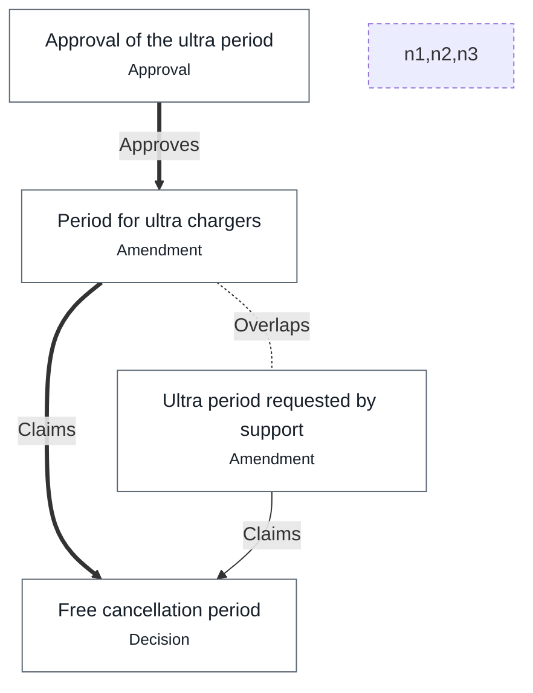

# Overlaps

*The values claimed by several nodes on 3 November 2026, and how each overlap was settled.*

## Free cancellation period · value.ultra

> Overlap on `value.ultra` of [Free cancellation period](cancellation.md#FreeCancellationPeriod), between [Period for ultra chargers](committee.md#UltraPeriod) and [Ultra period requested by support](support.md#SupportUltraPeriod): [Period for ultra chargers](committee.md#UltraPeriod) prevails (approved by lea, owner of "Free cancellation period"; see [Approval of the ultra period](committee.md#UltraPeriodApproval)).
