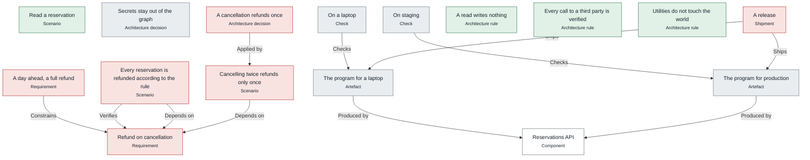

# Pipelines

*What trame ship runs for each shipment on 3 November 2026, in order, as the engine computes it: its artefacts produced, the checks a program makes, the obligations to prove, the programs that deploy it, the dossier.*

## A release

> **A release does not ship yet: 4 of 15 obligations hold.**

For the target production; its programs are assembled for [Production](infra.md#Production).

*Its steps, one rank per stage: produce, check, prove, deploy, record.*

|  | Stage | Step | Run by | Why | Status | Latest evidence |
|---|---|---|---|---|---|---|
| 1 | produce | [The program for a laptop](sdlc.md#LocalProgram) · `out/local/reservations-api.ts` | [Reservations API](architecture.md#ReservationsApi) | — | **unknown** |  |
| 2 | produce | [The program for production](sdlc.md#ProductionProgram) · `out/production/reservations-api.ts` | [Reservations API](architecture.md#ReservationsApi) | — | **unknown** |  |
| 3 | prove | The foundations (1 problem) | itself | every shipment: no literal in a body, a sound graph | **violated** |  |
| 4 | prove | [The program for a laptop](sdlc.md#LocalProgram) | — | the shipment | **unknown** |  |
| 5 | prove | [The program for production](sdlc.md#ProductionProgram) | — | the shipment | **unknown** |  |
| 6 | prove | [Read a reservation](scenarios.md#ReadScenario) | — | [The code is verified](sdlc.md#CodeVerified) via [Reservations in SQL](infra.md#ReservationsSql) | **held** |  |
| 7 | prove | [Cancelling twice refunds only once](scenarios.md#RepeatedCancellationScenario) | — | [The code is verified](sdlc.md#CodeVerified) via [Cancellations in SQL](infra.md#CancellationsSql) | **violated** |  |
| 8 | prove | [Every reservation is refunded according to the rule](scenarios.md#ComplianceScenario) | — | [The code is verified](sdlc.md#CodeVerified) via [Refund on cancellation](cancellation.md#Refund) | **violated** |  |
| 9 | prove | [Secrets stay out of the graph](principles.md#SecretsOutOfTheGraph) | — | [The decisions hold](sdlc.md#DecisionsApplied) via [Real payment provider](infra.md#HttpPayment) | **unknown** |  |
| 10 | prove | [A cancellation refunds once](principles.md#RefundOnce) | — | [The decisions hold](sdlc.md#DecisionsApplied) via [Key of a cancellation's refund](architecture.md#CancellationKey) | **violated** |  |
| 11 | prove | [On a laptop](sdlc.md#OnALaptop) | by hand, signed by [The operators](sdlc.md#Operators) | [Every check is signed](sdlc.md#EveryCheck) via [The program for a laptop](sdlc.md#LocalProgram) | **unknown** |  |
| 12 | prove | [On staging](sdlc.md#OnStaging) | by hand, signed by [The operators](sdlc.md#Operators) | [Every check is signed](sdlc.md#EveryCheck) via [The program for production](sdlc.md#ProductionProgram) | **unknown** |  |
| 13 | prove | [Refund on cancellation](cancellation.md#Refund) | — | [The requirements of the goal hold](sdlc.md#GoalServed) | **violated** |  |
| 14 | prove | [A day ahead, a full refund](consumer.md#FullRefundAhead) | — | [The requirements of the goal hold](sdlc.md#GoalServed) via [Refund on cancellation](cancellation.md#Refund) | **violated** |  |
| 15 | prove | [A read writes nothing](architecture.md#ReadWithoutWrite) | — | [The rules hold](sdlc.md#RulesHeld) | **held** |  |
| 16 | prove | [Every call to a third party is verified](architecture.md#ThirdPartiesVerified) | — | [The rules hold](sdlc.md#RulesHeld) | **held** |  |
| 17 | prove | [Utilities do not touch the world](architecture.md#UtilitiesWithoutWorld) | — | [The rules hold](sdlc.md#RulesHeld) | **held** |  |
| 18 | record | [A release](sdlc.md#Release) | — | — | **violated** |  |

`trame ship Release --by <name>`
