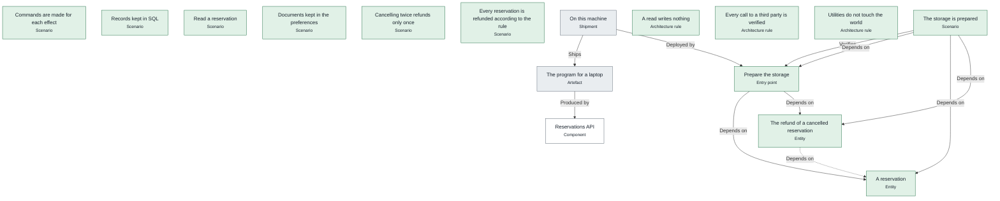

# Pipelines

*What trame ship runs for each shipment on 30 October 2026, in order, as the engine computes it: its artefacts produced, the checks a program makes, the obligations to prove, the programs that deploy it, the dossier.*

## On this machine

> **On this machine does not ship yet: 12 of 14 obligations hold.**

For the target local; its programs are assembled for [Local](infra.md#Local).

*Its steps, one rank per stage: produce, check, prove, deploy, record.*

|  | Stage | Step | Run by | Why | Status | Latest evidence |
|---|---|---|---|---|---|---|
| 1 | produce | [The program for a laptop](sdlc.md#LocalProgram) · `out/local/reservations-api.ts` | [Reservations API](architecture.md#ReservationsApi) | — | **unknown** |  |
| 2 | prove | The foundations (1 problem) | itself | every shipment: no literal in a body, a sound graph | **violated** |  |
| 3 | prove | [The program for a laptop](sdlc.md#LocalProgram) | — | the shipment | **unknown** |  |
| 4 | prove | [Commands are made for each effect](../../../std/docs/scenarios.md#CommandsMade) | — | [The code is verified](sdlc.md#CodeVerified) via [Commands](../../../std/docs/effects.md#Commands) | **held** |  |
| 5 | prove | [Records kept in SQL](../../../libs/data/docs/scenarios.md#RecordsKept) | — | [The code is verified](sdlc.md#CodeVerified) via [SQLite's tables](../../../libs/data/docs/records.md#SqliteTables) | **held** |  |
| 6 | prove | [Read a reservation](scenarios.md#ReadScenario) | — | [The code is verified](sdlc.md#CodeVerified) via [SQLite's tables](../../../libs/data/docs/records.md#SqliteTables) | **held** |  |
| 7 | prove | [Documents kept in the preferences](../../../libs/data/docs/scenarios.md#DocumentsKept) | — | [The code is verified](sdlc.md#CodeVerified) via [A value of the description it is of](../../../libs/data/docs/documents.md#Conforms) | **held** |  |
| 8 | prove | [Cancelling twice refunds only once](scenarios.md#RepeatedCancellationScenario) | — | [The code is verified](sdlc.md#CodeVerified) via [Cancellations as records](infra.md#CancellationRecords) | **held** |  |
| 9 | prove | [Every reservation is refunded according to the rule](scenarios.md#ComplianceScenario) | — | [The code is verified](sdlc.md#CodeVerified) via [Refund on cancellation](cancellation.md#Refund) | **held** |  |
| 10 | prove | [The storage is prepared](scenarios.md#StoragePrepared) | — | [The code is verified](sdlc.md#CodeVerified) via [Prepare the storage](sdlc.md#PrepareStorage) | **held** |  |
| 11 | prove | [The refund of a cancelled reservation](data.md#KeptRefund) | — | [What the service keeps, migrated](sdlc.md#KeptMigrates) | **held** |  |
| 12 | prove | [A reservation](data.md#KeptReservation) | — | [What the service keeps, migrated](sdlc.md#KeptMigrates) | **held** |  |
| 13 | prove | [A read writes nothing](architecture.md#ReadWithoutWrite) | — | [The rules hold](sdlc.md#RulesHeld) | **held** |  |
| 14 | prove | [Every call to a third party is verified](architecture.md#ThirdPartiesVerified) | — | [The rules hold](sdlc.md#RulesHeld) | **held** |  |
| 15 | prove | [Utilities do not touch the world](architecture.md#UtilitiesWithoutWorld) | — | [The rules hold](sdlc.md#RulesHeld) | **held** |  |
| 16 | deploy | [Prepare the storage](sdlc.md#PrepareStorage) | itself | — | **held** |  |
| 17 | record | [On this machine](sdlc.md#OnThisMachine) | — | — | **unknown** |  |

`trame ship OnThisMachine --by <name>`

## A release

> **A release does not ship yet: 17 of 23 obligations hold.**

For the target production; its programs are assembled for [Production](infra.md#Production).

```mermaid
flowchart TB
  n0["The program for a laptop<br/><small>Artefact</small>"]:::unknown
  n1["Reservations API<br/><small>Component</small>"]:::neutral
  n2["The program for production<br/><small>Artefact</small>"]:::unknown
  n3["Commands are made for each effect<br/><small>Scenario</small>"]:::held
  n4["PostgreSQL's statements<br/><small>Scenario</small>"]:::held
  n5["Records kept in SQL<br/><small>Scenario</small>"]:::held
  n6["Documents kept in the preferences<br/><small>Scenario</small>"]:::held
  n7["Read a reservation<br/><small>Scenario</small>"]:::held
  n8["Cancelling twice refunds only once<br/><small>Scenario</small>"]:::held
  n9["Every reservation is refunded according to the rule<br/><small>Scenario</small>"]:::held
  n10["An entity is described once<br/><small>Architecture decision</small>"]:::held
  n11["Secrets stay out of the graph<br/><small>Architecture decision</small>"]:::unknown
  n12["A cancellation refunds once<br/><small>Architecture decision</small>"]:::held
  n13["On a laptop<br/><small>Check</small>"]:::unknown
  n14["On staging<br/><small>Check</small>"]:::unknown
  n15["What a shipment stores migrates<br/><small>Requirement</small>"]:::held
  n16["Refund on cancellation<br/><small>Requirement</small>"]:::held
  n17["A day ahead, a full refund<br/><small>Requirement</small>"]:::held
  n18["The refund of a cancelled reservation<br/><small>Entity</small>"]:::held
  n19["A reservation<br/><small>Entity</small>"]:::held
  n20["A read writes nothing<br/><small>Architecture rule</small>"]:::held
  n21["Every call to a third party is verified<br/><small>Architecture rule</small>"]:::held
  n22["Utilities do not touch the world<br/><small>Architecture rule</small>"]:::held
  n23["A release<br/><small>Shipment</small>"]:::unknown
  n17 -->|Constrains| n16
  n12 -->|Applied by| n8
  n9 -->|Verifies| n16
  n9 -->|Depends on| n16
  n8 -->|Depends on| n16
  n0 -->|Produced by| n1
  n13 -->|Checks| n0
  n14 -->|Checks| n2
  n2 -->|Produced by| n1
  n23 -->|Ships| n2
  n23 -->|Ships| n0
  n18 -.->|Depends on| n19
  classDef held fill:#e1f1e7,stroke:#26734a,color:#17202a
  classDef blocked fill:#fbf0d9,stroke:#9a6200,color:#17202a
  classDef violated fill:#f9e3e1,stroke:#ad2a22,color:#17202a
  classDef unknown fill:#e9edf0,stroke:#65707c,color:#17202a
  classDef neutral fill:#ffffff,stroke:#5a6672,color:#17202a
```

*Its steps, one rank per stage: produce, check, prove, deploy, record.*

|  | Stage | Step | Run by | Why | Status | Latest evidence |
|---|---|---|---|---|---|---|
| 1 | produce | [The program for a laptop](sdlc.md#LocalProgram) · `out/local/reservations-api.ts` | [Reservations API](architecture.md#ReservationsApi) | — | **unknown** |  |
| 2 | produce | [The program for production](sdlc.md#ProductionProgram) · `out/production/reservations-api.ts` | [Reservations API](architecture.md#ReservationsApi) | — | **unknown** |  |
| 3 | prove | The foundations (1 problem) | itself | every shipment: no literal in a body, a sound graph | **violated** |  |
| 4 | prove | [The program for a laptop](sdlc.md#LocalProgram) | — | the shipment | **unknown** |  |
| 5 | prove | [The program for production](sdlc.md#ProductionProgram) | — | the shipment | **unknown** |  |
| 6 | prove | [Commands are made for each effect](../../../std/docs/scenarios.md#CommandsMade) | — | [The code is verified](sdlc.md#CodeVerified) via [Commands](../../../std/docs/effects.md#Commands) | **held** |  |
| 7 | prove | [PostgreSQL's statements](../../../libs/data/docs/scenarios.md#PostgresStatements) | — | [The code is verified](sdlc.md#CodeVerified) via [PostgreSQL's tables](../../../libs/data/docs/records.md#PostgresTables) | **held** |  |
| 8 | prove | [Records kept in SQL](../../../libs/data/docs/scenarios.md#RecordsKept) | — | [The code is verified](sdlc.md#CodeVerified) via [No records to start with](../../../libs/data/docs/records.md#StartEmpty) | **held** |  |
| 9 | prove | [Documents kept in the preferences](../../../libs/data/docs/scenarios.md#DocumentsKept) | — | [The code is verified](sdlc.md#CodeVerified) via [A value of the description it is of](../../../libs/data/docs/documents.md#Conforms) | **held** |  |
| 10 | prove | [Read a reservation](scenarios.md#ReadScenario) | — | [The code is verified](sdlc.md#CodeVerified) via [A value of the description it is of](../../../libs/data/docs/documents.md#Conforms) | **held** |  |
| 11 | prove | [Cancelling twice refunds only once](scenarios.md#RepeatedCancellationScenario) | — | [The code is verified](sdlc.md#CodeVerified) via [Cancellations as records](infra.md#CancellationRecords) | **held** |  |
| 12 | prove | [Every reservation is refunded according to the rule](scenarios.md#ComplianceScenario) | — | [The code is verified](sdlc.md#CodeVerified) via [Refund on cancellation](cancellation.md#Refund) | **held** |  |
| 13 | prove | [An entity is described once](../../../libs/data/docs/principles.md#DescribedOnce) | — | [The decisions hold](sdlc.md#DecisionsApplied) via [A value of the description it is of](../../../libs/data/docs/documents.md#Conforms) | **held** |  |
| 14 | prove | [Secrets stay out of the graph](principles.md#SecretsOutOfTheGraph) | — | [The decisions hold](sdlc.md#DecisionsApplied) via [Real payment provider](infra.md#HttpPayment) | **unknown** |  |
| 15 | prove | [A cancellation refunds once](principles.md#RefundOnce) | — | [The decisions hold](sdlc.md#DecisionsApplied) via [Key of a cancellation's refund](architecture.md#CancellationKey) | **held** |  |
| 16 | prove | [On a laptop](sdlc.md#OnALaptop) | by hand, signed by [The operators](sdlc.md#Operators) | [Every check is signed](sdlc.md#EveryCheck) via [The program for a laptop](sdlc.md#LocalProgram) | **unknown** |  |
| 17 | prove | [On staging](sdlc.md#OnStaging) | by hand, signed by [The operators](sdlc.md#Operators) | [Every check is signed](sdlc.md#EveryCheck) via [The program for production](sdlc.md#ProductionProgram) | **unknown** |  |
| 18 | prove | [What a shipment stores migrates](../../../libs/data/docs/obligations.md#Migrated) | — | [The requirements of the goal hold](sdlc.md#GoalServed) via [PostgreSQL's dialect](../../../libs/data/docs/sql.md#PostgresSql) | **held** |  |
| 19 | prove | [Refund on cancellation](cancellation.md#Refund) | — | [The requirements of the goal hold](sdlc.md#GoalServed) via [A reservation](data.md#KeptReservation) | **held** |  |
| 20 | prove | [A day ahead, a full refund](consumer.md#FullRefundAhead) | — | [The requirements of the goal hold](sdlc.md#GoalServed) via [A reservation](data.md#KeptReservation) | **held** |  |
| 21 | prove | [The refund of a cancelled reservation](data.md#KeptRefund) | — | [What the service keeps, migrated](sdlc.md#KeptMigrates) | **held** |  |
| 22 | prove | [A reservation](data.md#KeptReservation) | — | [What the service keeps, migrated](sdlc.md#KeptMigrates) | **held** |  |
| 23 | prove | [A read writes nothing](architecture.md#ReadWithoutWrite) | — | [The rules hold](sdlc.md#RulesHeld) | **held** |  |
| 24 | prove | [Every call to a third party is verified](architecture.md#ThirdPartiesVerified) | — | [The rules hold](sdlc.md#RulesHeld) | **held** |  |
| 25 | prove | [Utilities do not touch the world](architecture.md#UtilitiesWithoutWorld) | — | [The rules hold](sdlc.md#RulesHeld) | **held** |  |
| 26 | record | [A release](sdlc.md#Release) | — | — | **unknown** |  |

`trame ship Release --by <name>`
