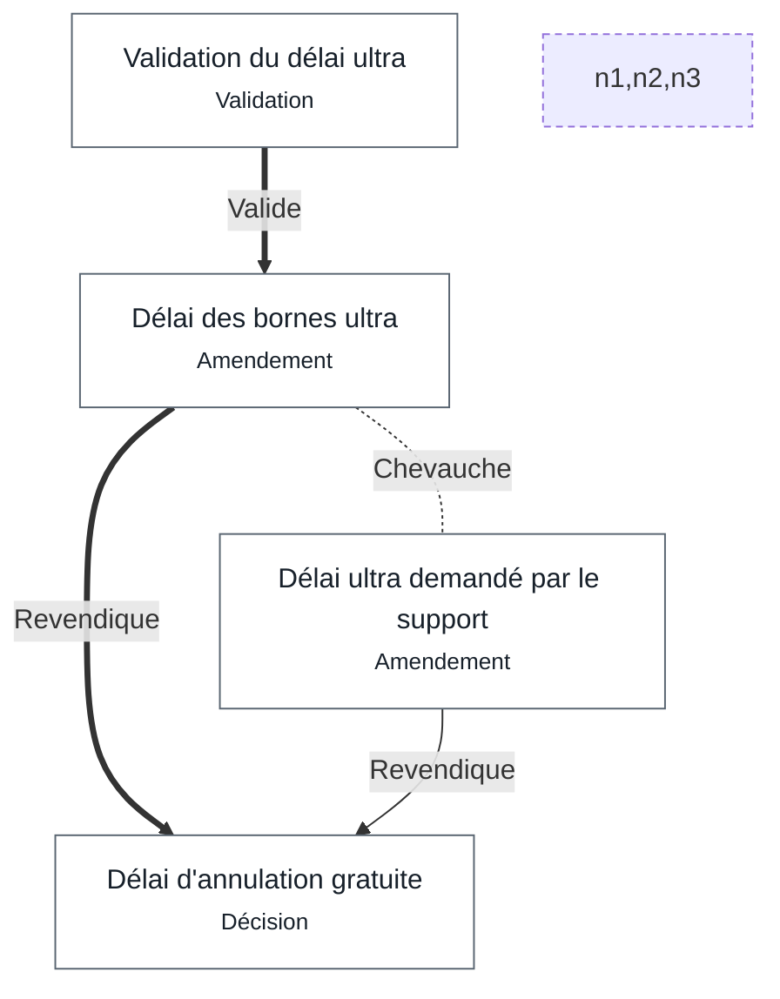

# Recoupements

*Les valeurs revendiquées par plusieurs nœuds le 17 octobre 2026, et comment chaque recoupement a été tranché.*

## Délai d'annulation gratuite · value.ultra

> Recoupement sur `value.ultra` de [Délai d'annulation gratuite](annulation.md#DelaiGratuit), entre [Délai des bornes ultra](comite.md#DelaiUltra) et [Délai ultra demandé par le support](support.md#DelaiUltraSupport) : [Délai des bornes ultra](comite.md#DelaiUltra) l'emporte (validé par lea, responsable de « Délai d'annulation gratuite » ; voir [Validation du délai ultra](comite.md#ValidationDelaiUltra)).
