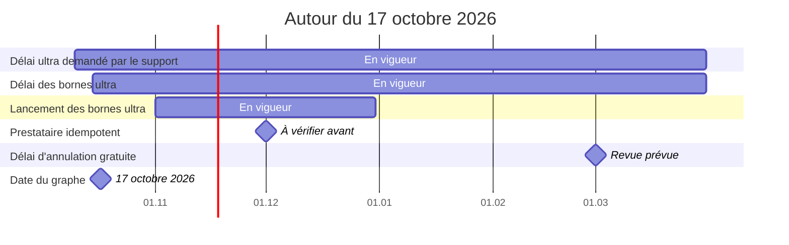

# Chronologie

*Ce qui entre en vigueur, s'arrête ou arrive à échéance, autour du 17 octobre 2026.*

*Les barres sont les périodes de validité, les repères les échéances et les revues. La ligne marque la date du graphe.*
