# Layers

*The graph in force on 26 October 2026, ordered by distance to the goals.*

```mermaid
flowchart TB
  subgraph algebra["Standard library · Algebra"]
    n0["Counts<br/><small>Algebraic structure</small>"]:::held
    n1["Sequences<br/><small>Algebraic structure</small>"]:::held
    n2["Texts<br/><small>Algebraic structure</small>"]:::held
    n3["Types of values<br/><small>Algebraic structure</small>"]:::held
  end
  subgraph algorithms["Standard library · Algorithms"]
    n4["Depth-first search<br/><small>Standard</small>"]:::neutral
    n5["Mulberry32<br/><small>Standard</small>"]:::neutral
    n6["Multiplicative hashing<br/><small>Standard</small>"]:::neutral
    n7["SHA-256<br/><small>Standard</small>"]:::neutral
  end
  subgraph ecmascript["Standard library · ECMAScript"]
    n8["ECMAScript<br/><small>Standard</small>"]:::neutral
    n9["ECMAScript reserved words<br/><small>Vocabulary</small>"]:::neutral
    n10["ECMAScript types<br/><small>Standard</small>"]:::neutral
    n11["Unicode escape of a text<br/><small>Standard</small>"]:::neutral
  end
  subgraph html["Standard library · HTML and CSS"]
    n12["WAI-ARIA<br/><small>Standard</small>"]:::neutral
    n13["CSS<br/><small>Standard</small>"]:::neutral
    n14["HTML<br/><small>Standard</small>"]:::neutral
    n15["SVG<br/><small>Standard</small>"]:::neutral
  end
  subgraph measures["Standard library · Measures"]
    n16["ISO 8601 dates<br/><small>Standard</small>"]:::neutral
    n17["Semantic versioning<br/><small>Standard</small>"]:::neutral
    n18["Units of measure<br/><small>Standard</small>"]:::neutral
  end
  subgraph patterns["Standard library · Design patterns"]
    n19["Abstract Factory<br/><small>Design pattern</small>"]:::unknown
    n20["Adapter<br/><small>Design pattern</small>"]:::unknown
    n21["Bridge<br/><small>Design pattern</small>"]:::unknown
    n22["Repository<br/><small>Design pattern</small>"]:::unknown
    n23["Strategy<br/><small>Design pattern</small>"]:::unknown
  end
  subgraph platform["Standard library · Platform"]
    n24["Animation frames<br/><small>Port</small>"]:::neutral
    n25["The screen kept awake, in memory<br/><small>Function</small>"]:::unknown
    n26["The browser's frames<br/><small>Implementation</small>"]:::neutral
    n27["The browser's languages<br/><small>Implementation</small>"]:::neutral
    n28["The browser loads the page<br/><small>Implementation</small>"]:::neutral
    n29["The browser keeps the preferences<br/><small>Implementation</small>"]:::neutral
    n30["The browser's voice<br/><small>Implementation</small>"]:::neutral
    n31["The browser keeps the screen awake<br/><small>Implementation</small>"]:::neutral
    n32["The device's services, as ports<br/><small>Architecture decision</small>"]:::unknown
    n33["Languages of the device<br/><small>Port</small>"]:::neutral
    n34["Frames turned by hand<br/><small>Function</small>"]:::unknown
    n35["Preferences kept in memory<br/><small>Function</small>"]:::unknown
    n36["Loading of a page<br/><small>Port</small>"]:::neutral
    n37["Preferences<br/><small>Port</small>"]:::neutral
    n38["Screen kept awake<br/><small>Port</small>"]:::neutral
    n39["Whether the screen is kept awake<br/><small>Port</small>"]:::neutral
    n40["What was said<br/><small>Port</small>"]:::neutral
    n41["Speech<br/><small>Port</small>"]:::neutral
    n42["A component in a browser starts with its page<br/><small>Architecture decision</small>"]:::unknown
    n43["Time turned by hand<br/><small>Port</small>"]:::neutral
    n44["A voice that writes down<br/><small>Function</small>"]:::unknown
  end
  subgraph product["Standard library · Product"]
    n45["A published value is cited, not copied<br/><small>Goal</small>"]:::neutral
    n46["Known designs, named<br/><small>Goal</small>"]:::neutral
    n47["Ports of the platform, realized once<br/><small>Goal</small>"]:::neutral
    n48["Shared operations instead of literals<br/><small>Goal</small>"]:::neutral
  end
  subgraph releases["Standard library · Releases"]
    n49["Version 0.1.0<br/><small>Release</small>"]:::neutral
    n50["Version 0.2.0<br/><small>Release</small>"]:::neutral
    n51["Version 0.3.0<br/><small>Release</small>"]:::neutral
  end
  subgraph system["Standard library · System"]
    n52["Exit status<br/><small>Standard</small>"]:::neutral
    n53["Node.js process arguments<br/><small>Standard</small>"]:::neutral
    n54["Node.js command line and child processes<br/><small>Standard</small>"]:::neutral
    n55["Node.js character encodings<br/><small>Standard</small>"]:::neutral
    n56["Node.js events<br/><small>Standard</small>"]:::neutral
    n57["Node.js module specifiers<br/><small>Standard</small>"]:::neutral
    n58["Node.js process and console<br/><small>Standard</small>"]:::neutral
    n59["npm's command line<br/><small>Standard</small>"]:::neutral
    n60["npm's manifest<br/><small>Standard</small>"]:::neutral
    n61["POSIX signals and errors<br/><small>Standard</small>"]:::neutral
  end
  subgraph text["Standard library · Text"]
    n62["Positions in a file<br/><small>Standard</small>"]:::neutral
    n63["Characters that do not show<br/><small>Standard</small>"]:::neutral
    n64["Text file<br/><small>Standard</small>"]:::neutral
    n65["Unified differences<br/><small>Standard</small>"]:::neutral
  end
  subgraph web["Standard library · Web"]
    n66["CSSOM View<br/><small>Standard</small>"]:::neutral
    n67["HTTP<br/><small>Standard</small>"]:::neutral
    n68["Media Queries Level 5<br/><small>Standard</small>"]:::neutral
    n69["Media types<br/><small>Standard</small>"]:::neutral
    n70["Screen Wake Lock API<br/><small>Standard</small>"]:::neutral
    n71["Server-sent events<br/><small>Standard</small>"]:::neutral
    n72["UI events<br/><small>Standard</small>"]:::neutral
    n73["URI<br/><small>Standard</small>"]:::neutral
  end
  n0 -->|Serves| n48
  n1 -->|Serves| n48
  n1 -->|Depends on| n8
  n1 -->|Depends on| n0
  n2 -->|Serves| n48
  n2 -->|Depends on| n1
  n3 -->|Serves| n48
  n3 -->|Depends on| n10
  n4 -->|Serves| n45
  n5 -->|Serves| n45
  n6 -->|Serves| n45
  n7 -->|Serves| n45
  n8 -->|Serves| n45
  n9 -->|Serves| n45
  n10 -->|Serves| n45
  n11 -->|Serves| n45
  n12 -->|Serves| n45
  n13 -->|Serves| n45
  n14 -->|Serves| n45
  n15 -->|Serves| n45
  n16 -->|Serves| n45
  n17 -->|Serves| n45
  n18 -->|Serves| n45
  n19 -->|Serves| n46
  n20 -->|Serves| n46
  n21 -->|Serves| n46
  n22 -->|Serves| n46
  n23 -->|Serves| n46
  n25 -->|Implements| n38
  n25 -->|Implements| n39
  n26 -->|Implements| n24
  n27 -->|Implements| n33
  n28 -->|Implements| n36
  n28 -->|Depends on| n72
  n29 -->|Implements| n37
  n30 -->|Implements| n41
  n31 -->|Implements| n38
  n31 -->|Depends on| n70
  n32 -->|Serves| n47
  n32 -->|Applied by| n37
  n32 -->|Applied by| n29
  n32 -->|Applied by| n35
  n32 -->|Applied by| n33
  n32 -->|Applied by| n27
  n32 -->|Applied by| n41
  n32 -->|Applied by| n30
  n32 -->|Applied by| n44
  n32 -->|Applied by| n40
  n32 -->|Applied by| n38
  n32 -->|Applied by| n31
  n32 -->|Applied by| n25
  n32 -->|Applied by| n39
  n32 -->|Applied by| n24
  n32 -->|Applied by| n26
  n32 -->|Applied by| n34
  n32 -->|Applied by| n43
  n34 -->|Implements| n24
  n34 -->|Implements| n43
  n34 -->|Depends on| n0
  n35 -->|Implements| n37
  n42 -->|Serves| n47
  n42 -->|Applied by| n36
  n42 -->|Applied by| n28
  n44 -->|Implements| n41
  n44 -->|Implements| n40
  n49 -->|Serves| n45
  n49 -->|Serves| n46
  n49 -->|Serves| n47
  n49 -->|Serves| n48
  n50 -->|Serves| n45
  n50 -->|Serves| n46
  n50 -->|Serves| n47
  n50 -->|Serves| n48
  n51 -->|Serves| n45
  n51 -->|Serves| n46
  n51 -->|Serves| n47
  n51 -->|Serves| n48
  n52 -->|Serves| n45
  n53 -->|Serves| n45
  n54 -->|Serves| n45
  n55 -->|Serves| n45
  n56 -->|Serves| n45
  n57 -->|Serves| n45
  n58 -->|Serves| n45
  n59 -->|Serves| n45
  n60 -->|Serves| n45
  n61 -->|Serves| n45
  n62 -->|Serves| n45
  n63 -->|Serves| n45
  n64 -->|Serves| n45
  n65 -->|Serves| n45
  n66 -->|Serves| n45
  n67 -->|Serves| n45
  n68 -->|Serves| n45
  n69 -->|Serves| n45
  n70 -->|Serves| n45
  n71 -->|Serves| n45
  n72 -->|Serves| n45
  n73 -->|Serves| n45
  classDef held fill:#e1f1e7,stroke:#26734a,color:#17202a
  classDef blocked fill:#fbf0d9,stroke:#9a6200,color:#17202a
  classDef violated fill:#f9e3e1,stroke:#ad2a22,color:#17202a
  classDef unknown fill:#e9edf0,stroke:#65707c,color:#17202a
  classDef neutral fill:#ffffff,stroke:#5a6672,color:#17202a
```

*Each rank is one edge further from a goal than the rank above it. The nodes connected to no goal are at the very bottom.*
