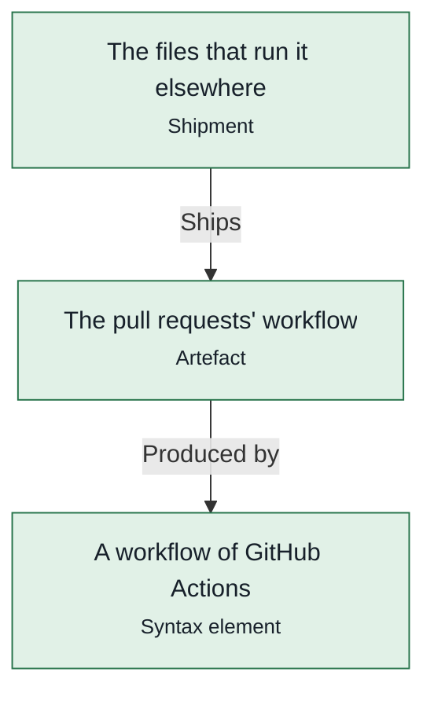

# Pipelines

*What trame ship runs for each shipment on 28 November 2026, in order, as the engine computes it: its artefacts produced, the checks a program makes, the obligations to prove, the programs that deploy it, the dossier.*

## The next version

> **The next version does not ship yet: 12 of 13 obligations hold.**

For the target version.

Run elsewhere by [The pull requests' workflow](sdlc.md#PullRequestWorkflow), written from this pipeline by trame ship.

```mermaid
flowchart TB
  n0["The commands of every project<br/><small>Artefact</small>"]:::unknown
  n1["A build writes the documents and the graph<br/><small>Scenario</small>"]:::held
  n2["After a build, nothing changes<br/><small>Scenario</small>"]:::held
  n3["A plan says what a build would change<br/><small>Scenario</small>"]:::held
  n4["trame dev serves the page<br/><small>Scenario</small>"]:::held
  n5["A page exported<br/><small>Scenario</small>"]:::held
  n6["A payload of the graph<br/><small>Scenario</small>"]:::held
  n7["Without a build, a plan says so<br/><small>Scenario</small>"]:::held
  n8["A snapshot writes the graph in force<br/><small>Scenario</small>"]:::held
  n9["A view answers its document<br/><small>Scenario</small>"]:::held
  n10["A command is played on a real graph<br/><small>Architecture decision</small>"]:::held
  n11["A command writes documents as a project does<br/><small>Architecture decision</small>"]:::held
  n12["The next version<br/><small>Shipment</small>"]:::unknown
  n12 -->|Ships| n0
  classDef held fill:#e1f1e7,stroke:#26734a,color:#17202a
  classDef blocked fill:#fbf0d9,stroke:#9a6200,color:#17202a
  classDef violated fill:#f9e3e1,stroke:#ad2a22,color:#17202a
  classDef unknown fill:#e9edf0,stroke:#65707c,color:#17202a
  classDef neutral fill:#ffffff,stroke:#5a6672,color:#17202a
```

*Its steps, one rank per stage: produce, check, prove, deploy, record.*

|  | Stage | Step | Run by | Why | Status | Latest evidence |
|---|---|---|---|---|---|---|
| 1 | produce | [The commands of every project](sdlc.md#TheLibrary) · `src` | — | — | **unknown** | 28 November 2026 by claude  |
| 2 | prove | The foundations | itself | every shipment: no literal in a body, a sound graph | **held** |  |
| 3 | prove | [The commands of every project](sdlc.md#TheLibrary) | — | the shipment | **unknown** | 28 November 2026 by claude  |
| 4 | prove | [A build writes the documents and the graph](scenarios.md#BuildWritesTheDocuments) | — | [Its code verified](sdlc.md#CodeVerified) via [Build](commands.md#Build) | **held** |  |
| 5 | prove | [After a build, nothing changes](scenarios.md#PlanAfterTheSameBuild) | — | [Its code verified](sdlc.md#CodeVerified) via [Two builds compared](commands.md#BuildComparison) | **held** |  |
| 6 | prove | [A plan says what a build would change](scenarios.md#PlanSaysWhatChanges) | — | [Its code verified](sdlc.md#CodeVerified) via [Two builds compared](commands.md#BuildComparison) | **held** |  |
| 7 | prove | [trame dev serves the page](scenarios.md#DevServesThePage) | — | [Its code verified](sdlc.md#CodeVerified) via [Dev](commands.md#Dev) | **held** |  |
| 8 | prove | [A page exported](scenarios.md#PageExported) | — | [Its code verified](sdlc.md#CodeVerified) via [Export](commands.md#Export) | **held** |  |
| 9 | prove | [A payload of the graph](scenarios.md#PayloadOfTheSmallProject) | — | [Its code verified](sdlc.md#CodeVerified) via [Payload](commands.md#Payload) | **held** |  |
| 10 | prove | [Without a build, a plan says so](scenarios.md#PlanWithoutABuild) | — | [Its code verified](sdlc.md#CodeVerified) via [Plan](commands.md#Plan) | **held** |  |
| 11 | prove | [A snapshot writes the graph in force](scenarios.md#SnapshotTaken) | — | [Its code verified](sdlc.md#CodeVerified) via [Snapshot](commands.md#Snapshot) | **held** |  |
| 12 | prove | [A view answers its document](scenarios.md#ViewAnswersItsDocument) | — | [Its code verified](sdlc.md#CodeVerified) via [View](commands.md#View) | **held** |  |
| 13 | prove | [A command is played on a real graph](scenarios.md#PlayedOnARealGraph) | — | [Its decisions applied](sdlc.md#DecisionsApplied) via [Compiled by the engine that plays them](scenarios.md#CompiledByTheEngine) | **held** |  |
| 14 | prove | [A command writes documents as a project does](scenarios.md#WrittenAsAProjectDoes) | — | [Its decisions applied](sdlc.md#DecisionsApplied) via [Files in Markdown, the terminal in text](scenarios.md#DocumentsAsFiles) | **held** |  |
| 15 | record | [The next version](sdlc.md#NextVersion) | — | — | **unknown** | 28 November 2026 by claude `evidence/shipments/NextVersion-2026-11-28-ae235c12.json` |

`trame ship NextVersion --by <name>`

## The files that run it elsewhere

> **The files that run it elsewhere ships: every obligation holds.**

For the target repository.

*Its steps, one rank per stage: produce, check, prove, deploy, record.*

|  | Stage | Step | Run by | Why | Status | Latest evidence |
|---|---|---|---|---|---|---|
| 1 | produce | [The pull requests' workflow](sdlc.md#PullRequestWorkflow) · `../../.github/workflows/commands-pull-request.yml` | [A workflow of GitHub Actions](../.trame/ci/docs/github.md#GitHubWorkflow) | — | **held** | 28 November 2026 by claude  |
| 2 | prove | The foundations | itself | every shipment: no literal in a body, a sound graph | **held** |  |
| 3 | prove | [The pull requests' workflow](sdlc.md#PullRequestWorkflow) | — | the shipment | **held** | 28 November 2026 by claude  |
| 4 | record | [The files that run it elsewhere](sdlc.md#RunnersWritten) | — | — | **held** | 28 November 2026 by claude `evidence/shipments/RunnersWritten-2026-11-28-b608bb93.json` |

`trame ship RunnersWritten --by <name>`
