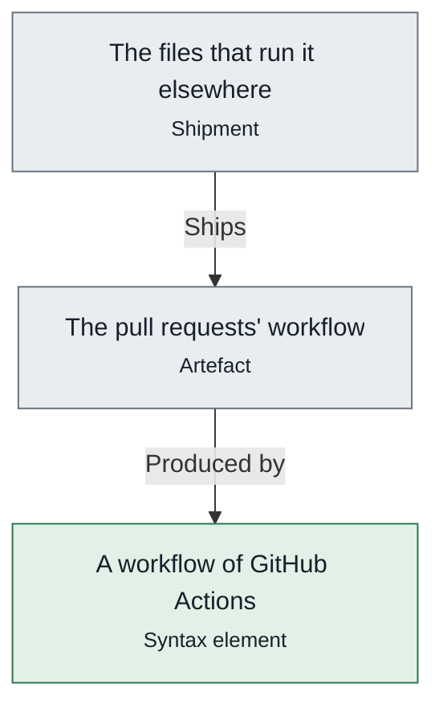

# Pipelines

*What trame ship runs for each shipment on 28 November 2026, in order, as the engine computes it: its artefacts produced, the checks a program makes, the obligations to prove, the programs that deploy it, the dossier.*

## The next version

> **The next version does not ship yet: 12 of 13 obligations hold.**

For the target version.

Run elsewhere by [The pull requests' workflow](sdlc.md#PullRequestWorkflow), written from this pipeline by trame ship.

```mermaid
flowchart TB
  n0["The renderers of documents<br/><small>Artefact</small>"]:::unknown
  n1["The explorer of a large graph<br/><small>Scenario</small>"]:::held
  n2["The language of the documents, written<br/><small>Scenario</small>"]:::held
  n3["A page made<br/><small>Scenario</small>"]:::held
  n4["Answers written in their formats<br/><small>Scenario</small>"]:::held
  n5["The documents, rendered<br/><small>Scenario</small>"]:::held
  n6["The documents in the page<br/><small>Scenario</small>"]:::held
  n7["The page is assembled<br/><small>Architecture decision</small>"]:::held
  n8["The documents speak the engine's language<br/><small>Architecture decision</small>"]:::held
  n9["A style sheet writes no value<br/><small>Architecture decision</small>"]:::held
  n10["One renderer, its syntax a choice<br/><small>Architecture decision</small>"]:::held
  n11["The scenarios render as a project does<br/><small>Architecture decision</small>"]:::held
  n12["The next version<br/><small>Shipment</small>"]:::unknown
  n12 -->|Ships| n0
  classDef held fill:#e1f1e7,stroke:#26734a,color:#17202a
  classDef blocked fill:#fbf0d9,stroke:#9a6200,color:#17202a
  classDef violated fill:#f9e3e1,stroke:#ad2a22,color:#17202a
  classDef unknown fill:#e9edf0,stroke:#65707c,color:#17202a
  classDef neutral fill:#ffffff,stroke:#5a6672,color:#17202a
```

*Its steps, one rank per stage: produce, check, prove, deploy, record.*

|  | Stage | Step | Run by | Why | Status | Latest evidence |
|---|---|---|---|---|---|---|
| 1 | produce | [The renderers of documents](sdlc.md#TheLibrary) · `src` | — | — | **unknown** | 28 November 2026 by claude  |
| 2 | prove | The foundations | itself | every shipment: no literal in a body, a sound graph | **held** |  |
| 3 | prove | [The renderers of documents](sdlc.md#TheLibrary) | — | the shipment | **unknown** | 28 November 2026 by claude  |
| 4 | prove | [The explorer of a large graph](scenarios.md#TheExplorerDraws) | — | [Its code verified](sdlc.md#CodeVerified) via [Explorer of a graph](browser.md#ExplorerFigures) | **held** |  |
| 5 | prove | [The language of the documents, written](scenarios.md#LanguageWritten) | — | [Its code verified](sdlc.md#CodeVerified) via [Dates](language.md#Dates) | **held** |  |
| 6 | prove | [A page made](scenarios.md#ThePageIsMade) | — | [Its code verified](sdlc.md#CodeVerified) via [Page](page.md#Page) | **held** |  |
| 7 | prove | [Answers written in their formats](scenarios.md#AnswersWritten) | — | [Its code verified](sdlc.md#CodeVerified) via [Documents at a terminal](rendering.md#AnswersAtATerminal) | **held** |  |
| 8 | prove | [The documents, rendered](scenarios.md#DocumentsRendered) | — | [Its code verified](sdlc.md#CodeVerified) via [Common rendering](rendering.md#Common) | **held** |  |
| 9 | prove | [The documents in the page](scenarios.md#DocumentsInThePage) | — | [Its code verified](sdlc.md#CodeVerified) via [HTML writer](rendering.md#HtmlSyntax) | **held** |  |
| 10 | prove | [The page is assembled](browser.md#ThePageIsAssembled) | — | [Its decisions applied](sdlc.md#DecisionsApplied) via [Explorer of a graph](browser.md#ExplorerFigures) | **held** |  |
| 11 | prove | [The documents speak the engine's language](scenarios.md#TheEnginesLanguage) | — | [Its decisions applied](sdlc.md#DecisionsApplied) via [Dates](language.md#Dates) | **held** |  |
| 12 | prove | [A style sheet writes no value](page.md#StyleThroughVariables) | — | [Its decisions applied](sdlc.md#DecisionsApplied) via [Rules of a narrow screen](page.md#NarrowScreenRule) | **held** |  |
| 13 | prove | [One renderer, its syntax a choice](rendering.md#OneRendererManySyntaxes) | — | [Its decisions applied](sdlc.md#DecisionsApplied) via [Rendering of the files](rendering.md#FileRendering) | **held** |  |
| 14 | prove | [The scenarios render as a project does](scenarios.md#HowTheScenariosRender) | — | [Its decisions applied](sdlc.md#DecisionsApplied) via [Figures in Mermaid](scenarios.md#FiguresInMermaid) | **held** |  |
| 15 | record | [The next version](sdlc.md#NextVersion) | — | — | **unknown** | 28 November 2026 by claude `evidence/shipments/NextVersion-2026-11-28-8cc6006e.json` |

`trame ship NextVersion --by <name>`

## The files that run it elsewhere

> **The files that run it elsewhere does not ship yet: 1 of 2 obligations holds.**

For the target repository.

*Its steps, one rank per stage: produce, check, prove, deploy, record.*

|  | Stage | Step | Run by | Why | Status | Latest evidence |
|---|---|---|---|---|---|---|
| 1 | produce | [The pull requests' workflow](sdlc.md#PullRequestWorkflow) · `../../.github/workflows/documents-pull-request.yml` | [A workflow of GitHub Actions](../.trame/ci/docs/github.md#GitHubWorkflow) | — | **unknown** | 28 November 2026 by claude  |
| 2 | prove | The foundations | itself | every shipment: no literal in a body, a sound graph | **held** |  |
| 3 | prove | [The pull requests' workflow](sdlc.md#PullRequestWorkflow) | — | the shipment | **unknown** | 28 November 2026 by claude  |
| 4 | record | [The files that run it elsewhere](sdlc.md#RunnersWritten) | — | — | **unknown** | 28 November 2026 by claude `evidence/shipments/RunnersWritten-2026-11-28-d0f31db5.json` |

`trame ship RunnersWritten --by <name>`
