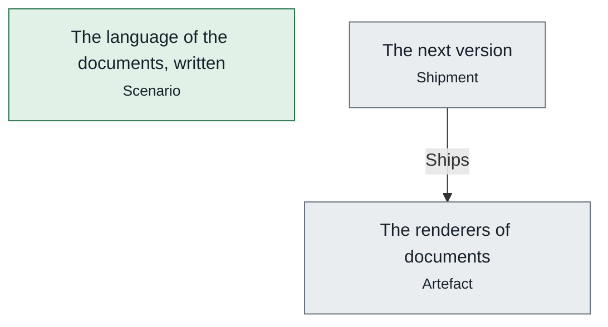
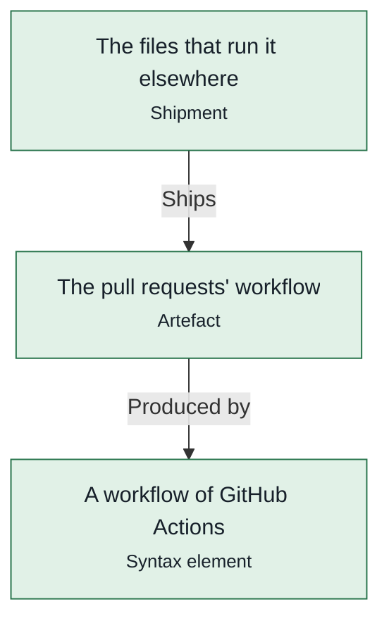

# Pipelines

*What trame ship runs for each shipment on 26 November 2026, in order, as the engine computes it: its artefacts produced, the checks a program makes, the obligations to prove, the programs that deploy it, the dossier.*

## The next version

> **The next version does not ship yet: 2 of 3 obligations hold.**

For the target version.

Run elsewhere by [The pull requests' workflow](sdlc.md#PullRequestWorkflow), written from this pipeline by trame ship.

*Its steps, one rank per stage: produce, check, prove, deploy, record.*

|  | Stage | Step | Run by | Why | Status | Latest evidence |
|---|---|---|---|---|---|---|
| 1 | produce | [The renderers of documents](sdlc.md#TheLibrary) · `src` | — | — | **unknown** |  |
| 2 | prove | The foundations | itself | every shipment: no literal in a body, a sound graph | **held** |  |
| 3 | prove | [The renderers of documents](sdlc.md#TheLibrary) | — | the shipment | **unknown** |  |
| 4 | prove | [The language of the documents, written](scenarios.md#LanguageWritten) | — | [Its code verified](sdlc.md#CodeVerified) via [Dates](language.md#Dates) | **held** |  |
| 5 | record | [The next version](sdlc.md#NextVersion) | — | — | **unknown** |  |

`trame ship NextVersion --by <name>`

## The files that run it elsewhere

> **The files that run it elsewhere ships: every obligation holds.**

For the target repository.

*Its steps, one rank per stage: produce, check, prove, deploy, record.*

|  | Stage | Step | Run by | Why | Status | Latest evidence |
|---|---|---|---|---|---|---|
| 1 | produce | [The pull requests' workflow](sdlc.md#PullRequestWorkflow) · `../../.github/workflows/documents-pull-request.yml` | [A workflow of GitHub Actions](../.trame/ci/docs/github.md#GitHubWorkflow) | — | **held** | 26 November 2026 by claude  |
| 2 | prove | The foundations | itself | every shipment: no literal in a body, a sound graph | **held** |  |
| 3 | prove | [The pull requests' workflow](sdlc.md#PullRequestWorkflow) | — | the shipment | **held** | 26 November 2026 by claude  |
| 4 | record | [The files that run it elsewhere](sdlc.md#RunnersWritten) | — | — | **held** | 26 November 2026 by claude `evidence/shipments/RunnersWritten-2026-11-26-784a8167.json` |

`trame ship RunnersWritten --by <name>`
