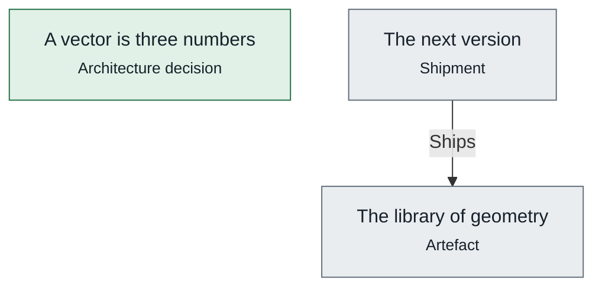

# Pipelines

*What trame ship runs for each shipment on 4 November 2026, in order, as the engine computes it: its artefacts produced, the checks a program makes, the obligations to prove, the programs that deploy it, the dossier.*

## The next version

> **The next version does not ship yet: 2 of 3 obligations hold.**

For the target version.

*Its steps, one rank per stage: produce, check, prove, deploy, record.*

|  | Stage | Step | Run by | Why | Status | Latest evidence |
|---|---|---|---|---|---|---|
| 1 | produce | [The library of geometry](sdlc.md#TheLibrary) · `src` | — | — | **unknown** | 4 November 2026 by claude  |
| 2 | prove | The foundations | itself | every shipment: no literal in a body, a sound graph | **held** |  |
| 3 | prove | [The library of geometry](sdlc.md#TheLibrary) | — | the shipment | **unknown** | 4 November 2026 by claude  |
| 4 | prove | [A vector is three numbers](vectors.md#VectorsAsTriples) | — | [Its decisions applied](sdlc.md#DecisionsApplied) via [Angle](angles.md#Angle) | **held** |  |
| 5 | record | [The next version](sdlc.md#NextVersion) | — | — | **unknown** | 4 November 2026 by claude `evidence/shipments/NextVersion-2026-11-04-7074b77f.json` |

`trame ship NextVersion --by <name>`
