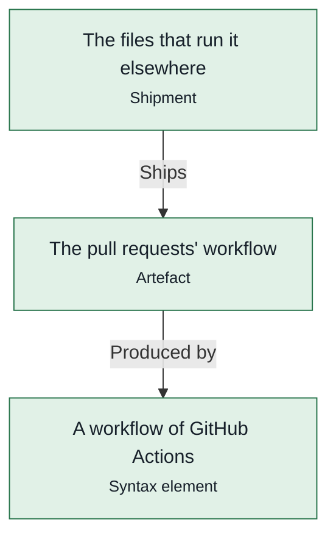

# Pipelines

*What trame ship runs for each shipment on 24 November 2026, in order, as the engine computes it: its artefacts produced, the checks a program makes, the obligations to prove, the programs that deploy it, the dossier.*

## The next version

> **The next version does not ship yet: 33 of 34 obligations hold.**

For the target version.

Run elsewhere by [The pull requests' workflow](sdlc.md#PullRequestWorkflow), written from this pipeline by trame ship.

```mermaid
flowchart TB
  n0["The standard library<br/><small>Artefact</small>"]:::unknown
  n1["A library offers commands, a project chooses them<br/><small>Architecture decision</small>"]:::held
  n2["A project judges harder than the language, never softer<br/><small>Architecture decision</small>"]:::held
  n3["An entry point says who may call it<br/><small>Architecture decision</small>"]:::held
  n4["The device's services, as ports<br/><small>Architecture decision</small>"]:::held
  n5["A repository is set by its project's graph<br/><small>Architecture decision</small>"]:::held
  n6["The SDLC's tooling is realized once<br/><small>Architecture decision</small>"]:::held
  n7["Seeded draws keep their promise<br/><small>Scenario</small>"]:::held
  n8["A pull request merged once it holds<br/><small>Scenario</small>"]:::held
  n9["A pull request opened<br/><small>Scenario</small>"]:::held
  n10["A version carried across the projects<br/><small>Scenario</small>"]:::held
  n11["Commands are made for each effect<br/><small>Scenario</small>"]:::held
  n12["Judged as the language says<br/><small>Scenario</small>"]:::held
  n13["Judged strictly<br/><small>Scenario</small>"]:::held
  n14["The device, in memory<br/><small>Scenario</small>"]:::held
  n15["A repository kept in memory<br/><small>Scenario</small>"]:::held
  n16["The tooling, in memory<br/><small>Scenario</small>"]:::held
  n17["Playwright<br/><small>Package</small>"]:::held
  n18["The decisions a shipment applies hold<br/><small>Requirement</small>"]:::held
  n19["The artefacts a shipment ships are checked<br/><small>Requirement</small>"]:::held
  n20["Who calls a shipment's programs is identified<br/><small>Requirement</small>"]:::held
  n21["The artefacts a shipment ships were shipped first by those that precede it<br/><small>Requirement</small>"]:::held
  n22["What people decided is published<br/><small>Requirement</small>"]:::held
  n23["The data a shipment carries is reviewed<br/><small>Requirement</small>"]:::held
  n24["The project's rules hold<br/><small>Requirement</small>"]:::held
  n25["The packages a shipment uses are safe<br/><small>Requirement</small>"]:::held
  n26["The product a shipment serves holds<br/><small>Requirement</small>"]:::held
  n27["The code a shipment ships is verified<br/><small>Requirement</small>"]:::held
  n28["As many links as asked<br/><small>Requirement</small>"]:::held
  n29["A node never reaches what it must not<br/><small>Requirement</small>"]:::held
  n30["A node reaches what it must<br/><small>Requirement</small>"]:::held
  n31["Effects a node may not have<br/><small>Requirement</small>"]:::held
  n32["Words of a vocabulary<br/><small>Requirement</small>"]:::held
  n33["The next version<br/><small>Shipment</small>"]:::unknown
  n3 -->|Applied by| n20
  n33 -->|Ships| n0
  classDef held fill:#e1f1e7,stroke:#26734a,color:#17202a
  classDef blocked fill:#fbf0d9,stroke:#9a6200,color:#17202a
  classDef violated fill:#f9e3e1,stroke:#ad2a22,color:#17202a
  classDef unknown fill:#e9edf0,stroke:#65707c,color:#17202a
  classDef neutral fill:#ffffff,stroke:#5a6672,color:#17202a
```

*Its steps, one rank per stage: produce, check, prove, deploy, record.*

|  | Stage | Step | Run by | Why | Status | Latest evidence |
|---|---|---|---|---|---|---|
| 1 | produce | [The standard library](sdlc.md#TheLibrary) · `src` | — | — | **unknown** | 22 November 2026 by claude  |
| 2 | prove | The foundations | itself | every shipment: no literal in a body, a sound graph | **held** |  |
| 3 | prove | [The standard library](sdlc.md#TheLibrary) | — | the shipment | **unknown** | 22 November 2026 by claude  |
| 4 | prove | [A library offers commands, a project chooses them](commands.md#CommandsOfALibrary) | — | [Its decisions applied](sdlc.md#DecisionsApplied) via [The library's commands](commands.md#LibraryCommands) | **held** |  |
| 5 | prove | [A project judges harder than the language, never softer](judgment.md#HarderNeverSofter) | — | [Its decisions applied](sdlc.md#DecisionsApplied) via [As the language says](judgment.md#AsTheLanguageSays) | **held** |  |
| 6 | prove | [An entry point says who may call it](access.md#SaysItsAudience) | — | [Its decisions applied](sdlc.md#DecisionsApplied) via [Who calls a shipment's programs is identified](obligations.md#Identified) | **held** |  |
| 7 | prove | [The device's services, as ports](platform.md#DeviceAsPorts) | — | [Its decisions applied](sdlc.md#DecisionsApplied) via [Animation frames](platform.md#AnimationFrames) | **held** |  |
| 8 | prove | [A repository is set by its project's graph](repository.md#RepositoryThroughItsApi) | — | [Its decisions applied](sdlc.md#DecisionsApplied) via [GitHub's command line](repository.md#GitHubCliRepository) | **held** |  |
| 9 | prove | [The SDLC's tooling is realized once](tooling.md#ToolingAsPorts) | — | [Its decisions applied](sdlc.md#DecisionsApplied) via [A browser kept in memory](tooling.md#BrowserInMemory) | **held** |  |
| 10 | prove | [Seeded draws keep their promise](scenarios.md#DrawsKeepTheirPromise) | — | [Its functions verified](sdlc.md#FunctionsVerified) via [Seeded draws](algorithms.md#SeededDraws) | **held** |  |
| 11 | prove | [A pull request merged once it holds](scenarios.md#MergedOnceItHolds) | — | [Its functions verified](sdlc.md#FunctionsVerified) via [Merge a pull request](commands.md#MergePullRequest) | **held** |  |
| 12 | prove | [A pull request opened](scenarios.md#PullRequestOpened) | — | [Its functions verified](sdlc.md#FunctionsVerified) via [Open a pull request](commands.md#OpenPullRequest) | **held** |  |
| 13 | prove | [A version carried across the projects](scenarios.md#PropagatedInOrder) | — | [Its functions verified](sdlc.md#FunctionsVerified) via [Propagate](commands.md#Propagate) | **held** |  |
| 14 | prove | [Commands are made for each effect](scenarios.md#CommandsMade) | — | [Its functions verified](sdlc.md#FunctionsVerified) via [Commands](effects.md#Commands) | **held** |  |
| 15 | prove | [Judged as the language says](scenarios.md#JudgedAsTheLanguage) | — | [Its functions verified](sdlc.md#FunctionsVerified) via [As the language says](judgment.md#AsTheLanguageSays) | **held** |  |
| 16 | prove | [Judged strictly](scenarios.md#JudgedStrictly) | — | [Its functions verified](sdlc.md#FunctionsVerified) via [Every warning an error](judgment.md#EveryWarning) | **held** |  |
| 17 | prove | [The device, in memory](scenarios.md#DeviceInMemory) | — | [Its functions verified](sdlc.md#FunctionsVerified) via [The screen kept awake, in memory](platform.md#AwakeInMemory) | **held** |  |
| 18 | prove | [A repository kept in memory](scenarios.md#RepositoryInMemoryKeeps) | — | [Its functions verified](sdlc.md#FunctionsVerified) via [A repository compared with its settings](repository.md#RepositoryCompared) | **held** |  |
| 19 | prove | [The tooling, in memory](scenarios.md#ToolingInMemory) | — | [Its functions verified](sdlc.md#FunctionsVerified) via [A browser kept in memory](tooling.md#BrowserInMemory) | **held** |  |
| 20 | prove | [Playwright](tooling.md#PlaywrightPackage) | — | [Its packages safe](sdlc.md#PackagesSafe) via [Chromium, driven by Playwright](tooling.md#PlaywrightBrowser) | **held** | 27 October 2026 by   |
| 21 | prove | [The decisions a shipment applies hold](obligations.md#Applied) | — | [Its requirements held](sdlc.md#RequirementsServed) via [Anyone](access.md#Anyone) | **held** |  |
| 22 | prove | [The artefacts a shipment ships are checked](obligations.md#Checked) | — | [Its requirements held](sdlc.md#RequirementsServed) via [Anyone](access.md#Anyone) | **held** |  |
| 23 | prove | [Who calls a shipment's programs is identified](obligations.md#Identified) | — | [Its requirements held](sdlc.md#RequirementsServed) via [Anyone](access.md#Anyone) | **held** |  |
| 24 | prove | [The artefacts a shipment ships were shipped first by those that precede it](obligations.md#Preceded) | — | [Its requirements held](sdlc.md#RequirementsServed) via [Anyone](access.md#Anyone) | **held** |  |
| 25 | prove | [What people decided is published](obligations.md#Published) | — | [Its requirements held](sdlc.md#RequirementsServed) via [Anyone](access.md#Anyone) | **held** |  |
| 26 | prove | [The data a shipment carries is reviewed](obligations.md#Reviewed) | — | [Its requirements held](sdlc.md#RequirementsServed) via [Anyone](access.md#Anyone) | **held** |  |
| 27 | prove | [The project's rules hold](obligations.md#Ruled) | — | [Its requirements held](sdlc.md#RequirementsServed) via [Anyone](access.md#Anyone) | **held** |  |
| 28 | prove | [The packages a shipment uses are safe](obligations.md#Safe) | — | [Its requirements held](sdlc.md#RequirementsServed) via [Anyone](access.md#Anyone) | **held** |  |
| 29 | prove | [The product a shipment serves holds](obligations.md#Served) | — | [Its requirements held](sdlc.md#RequirementsServed) via [Anyone](access.md#Anyone) | **held** |  |
| 30 | prove | [The code a shipment ships is verified](obligations.md#Verified) | — | [Its requirements held](sdlc.md#RequirementsServed) via [Anyone](access.md#Anyone) | **held** |  |
| 31 | prove | [As many links as asked](rules.md#Linked) | — | [Its requirements held](sdlc.md#RequirementsServed) via [Anyone](access.md#Anyone) | **held** |  |
| 32 | prove | [A node never reaches what it must not](rules.md#NeverReaches) | — | [Its requirements held](sdlc.md#RequirementsServed) via [Anyone](access.md#Anyone) | **held** |  |
| 33 | prove | [A node reaches what it must](rules.md#Reaches) | — | [Its requirements held](sdlc.md#RequirementsServed) via [Anyone](access.md#Anyone) | **held** |  |
| 34 | prove | [Effects a node may not have](rules.md#WithoutEffects) | — | [Its requirements held](sdlc.md#RequirementsServed) via [Anyone](access.md#Anyone) | **held** |  |
| 35 | prove | [Words of a vocabulary](rules.md#WordsOf) | — | [Its requirements held](sdlc.md#RequirementsServed) via [Anyone](access.md#Anyone) | **held** |  |
| 36 | record | [The next version](sdlc.md#NextVersion) | — | — | **unknown** | 22 November 2026 by claude `evidence/shipments/NextVersion-2026-11-22-ea895e4e.json` |

`trame ship NextVersion --by <name>`

## The files that run it elsewhere

> **The files that run it elsewhere ships: every obligation holds.**

For the target repository.

*Its steps, one rank per stage: produce, check, prove, deploy, record.*

|  | Stage | Step | Run by | Why | Status | Latest evidence |
|---|---|---|---|---|---|---|
| 1 | produce | [The pull requests' workflow](sdlc.md#PullRequestWorkflow) · `../.github/workflows/std-pull-request.yml` | [A workflow of GitHub Actions](../.trame/ci/docs/github.md#GitHubWorkflow) | — | **held** | 22 November 2026 by claude  |
| 2 | prove | The foundations | itself | every shipment: no literal in a body, a sound graph | **held** |  |
| 3 | prove | [The pull requests' workflow](sdlc.md#PullRequestWorkflow) | — | the shipment | **held** | 22 November 2026 by claude  |
| 4 | record | [The files that run it elsewhere](sdlc.md#RunnersWritten) | — | — | **held** | 22 November 2026 by claude `evidence/shipments/RunnersWritten-2026-11-22-5f602b81.json` |

`trame ship RunnersWritten --by <name>`
